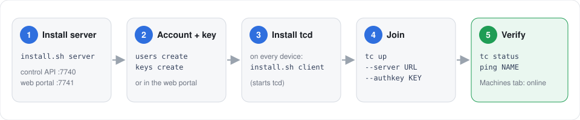
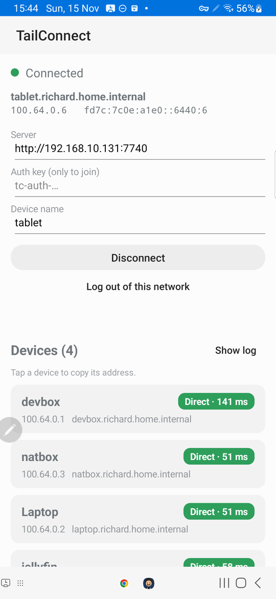
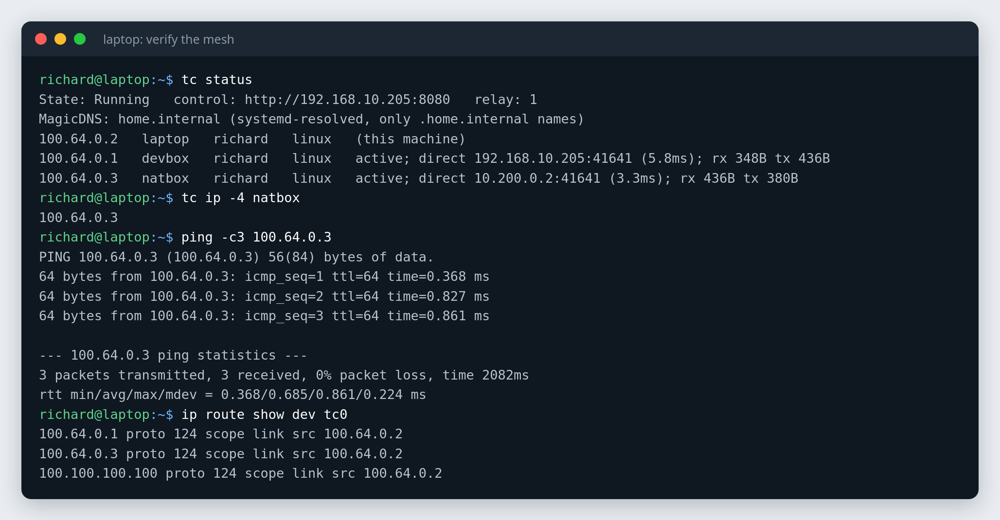
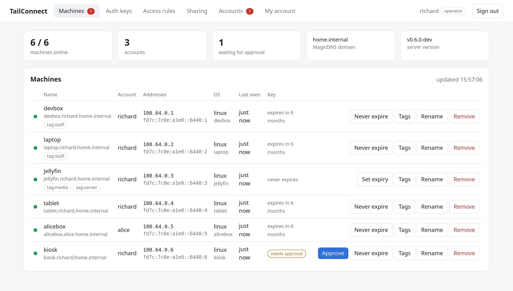

# Quick start

From nothing to two connected devices and the web portal in about ten minutes. You need a Linux machine for the server (a small VM or a Raspberry Pi is plenty) and at least one device to join: Linux, or an [Android](docs/android.md) phone or tablet.



**Decide where the server goes first.** It decides the address devices use and which ports to open:
- **only on your LAN:** devices use `http://192.168.1.10:7740`;
- **on the internet:** devices use `https://vpn.example.com`;
- **at home but reachable from outside.**

[LAN and internet setups](docs/network-setups.md) explains each. The steps below work for all three. `SERVER` means the address you picked.

---

## 1. Get the software

Download the tarball for your server's architecture (`amd64` or `arm64`) from the project's Releases page, or build it with `make dist` ([how](docs/installation.md#get-the-software)). Then unpack it:

```sh
tar xzf tailconnect-v0.6.0-dev-linux-amd64.tar.gz && cd tailconnect-v0.6.0-dev-linux-amd64
```

The same tarball has the server, the client, the installer and these docs.

## 2. Install the server

```sh
sudo ./packaging/linux/install.sh server
sudo tc-control users create alice -operator -password             # your account; prompts for a password
sudo tc-control keys create -user alice -reusable -expiration 24h  # prints tc-auth-…, a key for joining devices
```

Pick your MagicDNS domain now: renaming later renames every machine. Set it in `/etc/default/tc-control`:

```sh
TC_CONTROL_ARGS="-domain home.internal"
```

On the internet, also turn on HTTPS with a free certificate. The DNS name must point at the server, and port 443 must be open:

```sh
TC_CONTROL_ARGS="-domain home.internal -listen :443 -acme-domain vpn.example.com"
```

```sh
sudo systemctl restart tc-control
```

Then open the firewall:

| | LAN only | Internet (HTTPS) |
|---|---|---|
| Control and relay | TCP 7740 (from the LAN) | TCP 443 |
| STUN | UDP 3478 (from the LAN) | UDP 3478 |

```sh
sudo ufw allow 7740/tcp && sudo ufw allow 3478/udp      # LAN only
sudo ufw allow 443/tcp && sudo ufw allow 3478/udp       # internet
```

Details: [Installation](docs/installation.md#install-the-control-server), [HTTPS with Let's Encrypt](docs/lets-encrypt.md).

## 3. Join your devices

**Linux**, from the same tarball:

```sh
sudo ./packaging/linux/install.sh client
sudo tc up --server http://SERVER:7740 --authkey tc-auth-…          # LAN
sudo tc up --server https://vpn.example.com --authkey tc-auth-…     # internet
```

**Android:** build and install the app ([how](docs/android.md#build-the-app)), then enter the server, the auth key and a name, and tap Connect.



The auth key is needed only to join. Afterwards, devices reconnect by themselves.

## 4. Check it

On a Linux device:

```sh
tc status            # this device, its peers, and how each is reached
ping laptop          # other devices by name
```



`direct` means the devices talk to each other directly; `relay 1` means through the server's relay. Both work; direct is faster. If something's off, see [Troubleshooting](docs/troubleshooting.md).

## 5. Open the web portal

The portal listens on the server only. From your workstation:

```sh
ssh -L 7741:127.0.0.1:7741 you@SERVER       # then open http://localhost:7741 and sign in as alice
```



Here you manage machines, auth keys, access rules, sharing and accounts. [The web portal](docs/portal.md) explains every tab and setting.

---

## Next steps

| To… | See |
|---|---|
| Let other people sign up and run their own networks on your server | [Accounts and sign-up](docs/usage.md#accounts-and-sign-up), [Open the portal to other people](docs/installation.md#open-the-portal-to-other-people) |
| Share one machine (a media server, a printer) with another account | [Sharing a machine](docs/usage.md#sharing-a-machine) |
| Limit which machines can reach which | [Access rules](docs/usage.md#access-rules) |
| Approve new machines before they join | [My account](docs/portal.md#my-account) |
| Move from a LAN server to an internet one without re-joining | [Moving from one setup to another](docs/network-setups.md#moving-from-one-setup-to-another) |
| Monitor the server and devices | [Monitoring](docs/usage.md#monitoring) |
| Change any setting | [Settings at a glance](docs/configuration.md#settings-at-a-glance) |
