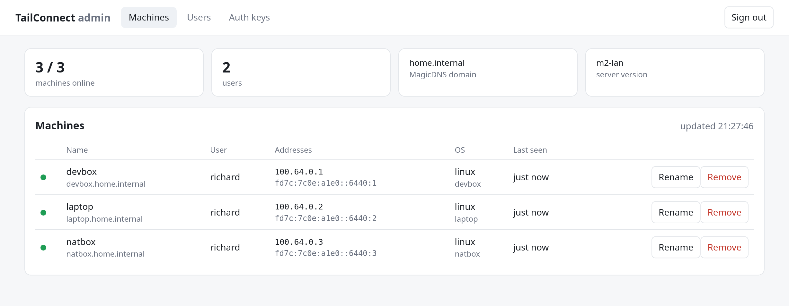
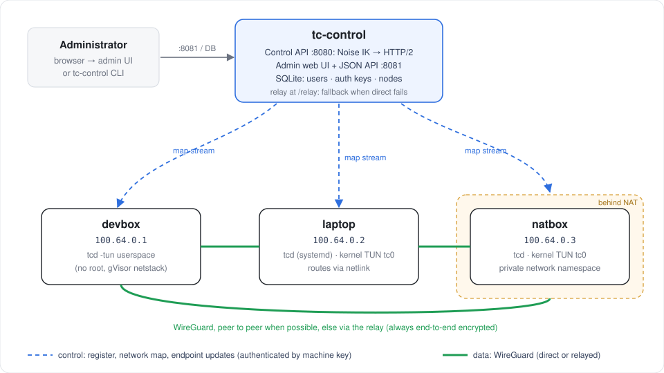
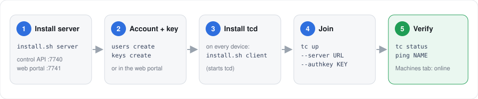
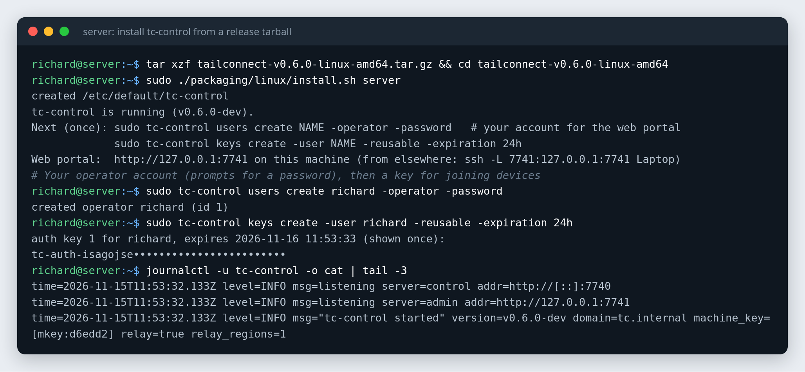
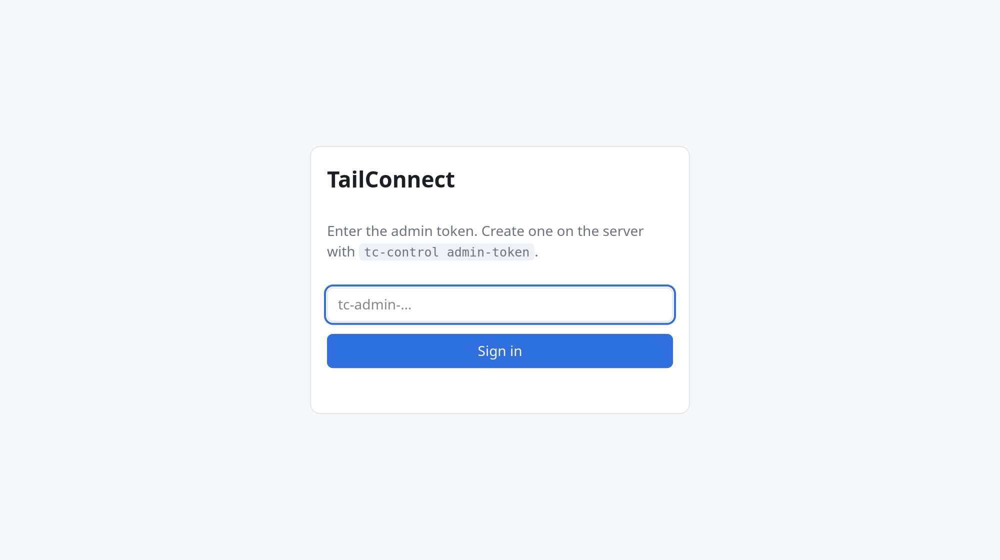
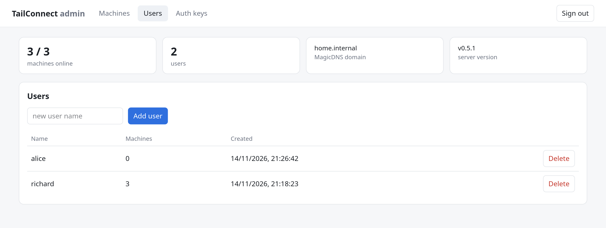
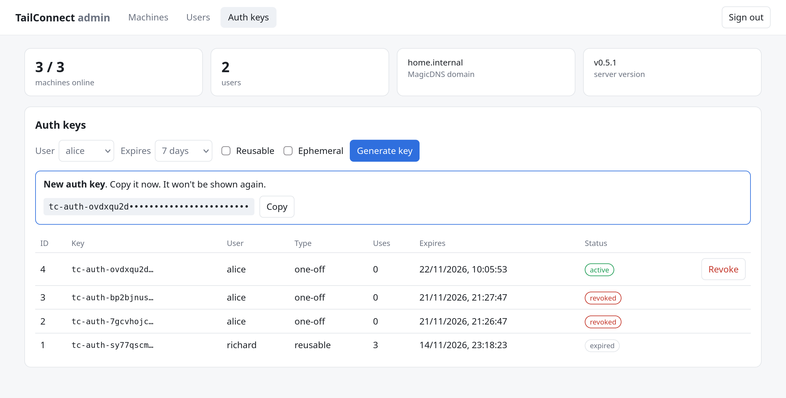
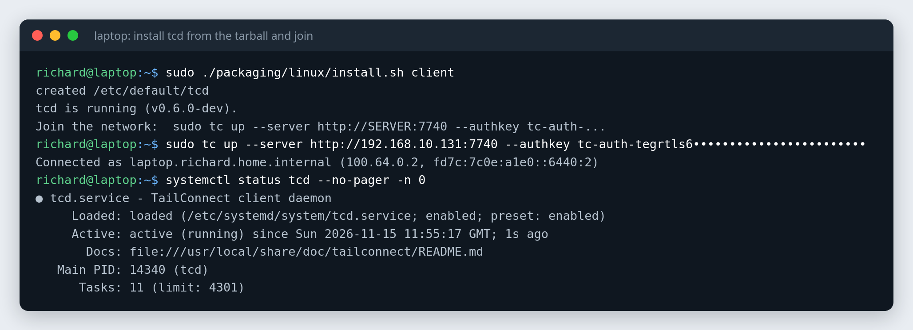
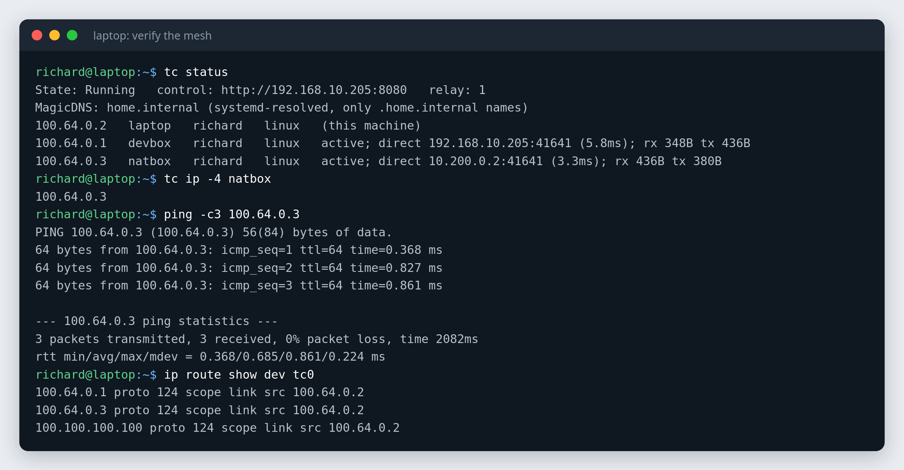
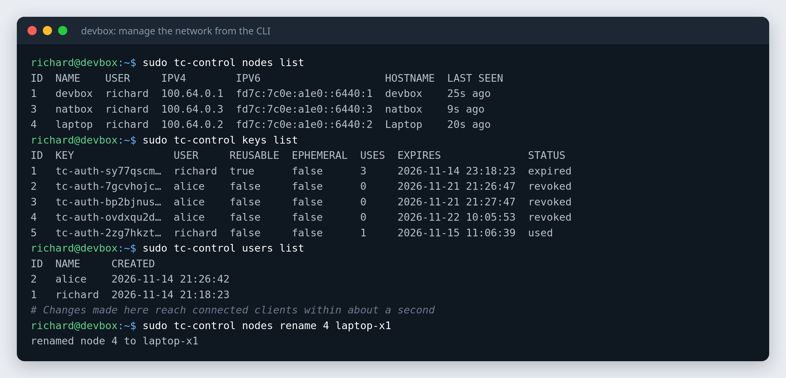

# TailConnect

A self-hosted mesh VPN built on WireGuard, for Linux, Windows and Android. One small coordination server hands out addresses and keys. Every device then talks to every other device directly over WireGuard.

**Status: milestone 4.** Linux client, an encrypted and authenticated control channel, and a WireGuard mesh with NAT traversal. Devices behind different NATs connect directly by hole punching, and fall back to a relay when that's impossible (blocked UDP, very strict NATs). MagicDNS, Windows and Android are next (see [Roadmap](#roadmap)).

<picture>
  <source media="(prefers-color-scheme: dark)" srcset="docs/images/admin-machines-dark.png">
  
</picture>

<sub>Every screenshot and terminal image in this README comes from a real test network: two physical machines on a home LAN, one of them also hosting a node behind NAT. Use your own addresses in place of `192.168.10.x`. Secrets are masked.</sub>

---

## Contents

- [How it works](#how-it-works)
- [Setup](#setup)
  - [1. Build](#1-build)
  - [2. Set up the control server](#2-set-up-the-control-server)
  - [3. Use the admin web UI](#3-use-the-admin-web-ui)
  - [4. Install and join clients](#4-install-and-join-clients)
  - [5. Verify the mesh](#5-verify-the-mesh)
  - [Manage from the command line](#manage-from-the-command-line)
- [Configuration reference](#configuration-reference)
- [Security notes](#security-notes)
- [Code layout](#code-layout)
- [Development](#development)
- [Roadmap](#roadmap)

---

## How it works



1. **Join.** `tc up --server URL --authkey KEY` asks the local daemon `tcd` to register. `tcd` fetches the server's public key from `GET /key` and pins it. It then opens a Noise IK channel, which proves the device's machine key to the server, and registers its WireGuard (node) key. The server gives it an address from `100.64.0.0/10`, plus a matching IPv6 ULA.
2. **Map stream.** `tcd` keeps a streaming request open over that channel. `tc-control` pushes a new network map whenever something peers can see changes: a node joins or leaves, reports new endpoints, or is renamed. That includes edits from the admin UI or the CLI, which reach clients within about a second.
3. **Data plane.** Each map is applied to WireGuard as a diff, so existing sessions survive. Every peer gets a /32 or /128 route on `tc0`.
4. **Direct or relayed.** *magicsock*, TailConnect's WireGuard transport, picks a path for every packet. It sends directly over a path that has been confirmed, and otherwise through the **relay** built into `tc-control`. The relay only forwards packets that are already WireGuard-encrypted. A direct path that stops answering is detected in about 3 seconds, and traffic moves to the relay.
5. **NAT traversal.** Each node learns its public address with **STUN**, sent from its WireGuard socket to `tc-control` (UDP 3478), and advertises it. When two peers start talking, they exchange authenticated **disco** pings with each other's addresses. A *CallMeMaybe* message sent through the relay makes both sides send at the same moment, which opens a hole in both NATs. The first authenticated pong confirms the path and measures its latency, and heartbeat pings keep it, and the NAT mapping, alive while the peers are active. Each node picks the relay region with the lowest STUN round-trip time as its home relay.
6. **Resilience.** If the control server goes away, the tunnel keeps running on the last map and `tcd` reconnects with backoff. If an admin removes a device, its tunnel is torn down and it must log in again.

---

## Setup



### 1. Build

Requires Go 1.26. With the default `GOTOOLCHAIN=auto`, an older Go downloads 1.26 automatically.

```sh
git clone <this repo> && cd TailConnect
go build -o bin/ ./cmd/...        # → bin/tc-control, bin/tcd, bin/tc
```

All three binaries are static Go programs with no cgo, so you can copy them to other machines as they are.

### 2. Set up the control server

Run these on the machine every device can reach:



| Step | Command | Notes |
|---|---|---|
| Choose a database | `export TC_CONTROL_DB=/var/lib/tc-control/control.db` | Or pass `-db PATH` to each command. Default: `./control.db`. |
| Create a user | `tc-control users create richard` | Every device belongs to a user. |
| Create a pre-auth key | `tc-control keys create -user richard -reusable -expiration 24h` | Printed once. Leave out `-reusable` for a single-use key. |
| Create the admin token | `tc-control admin-token` | Printed once. Running it again replaces the token and signs out every session. |
| Start the server | `tc-control serve -listen :8080 -domain home.internal` | Control API on `:8080`, admin UI on `127.0.0.1:8081`. |

To run it as a service, copy [packaging/linux/tc-control.service](packaging/linux/tc-control.service) to `/etc/systemd/system/` and run `systemctl enable --now tc-control`.

> **Firewall:** clients need **TCP 8080** to reach the control server, and devices need **UDP 41641** to reach each other. Keep the admin port (8081) on localhost, or put it behind TLS.

### 3. Use the admin web UI

Open `http://127.0.0.1:8081` on the server, or tunnel to it with `ssh -L 8081:127.0.0.1:8081 server`. Sign in with the admin token.

<table>
<tr>
<td width="50%"><br><sub><b>Sign in</b> with the <code>tc-admin-…</code> token.</sub></td>
<td width="50%"><br><sub><b>Users</b>: add users. Deleting a user also removes their machines and keys.</sub></td>
</tr>
</table>

**Auth keys:** pick a user, an expiry, and whether the key can be reused. Click *Generate key* and copy it; it is shown only once. Revoking a key stops new registrations with it, but machines that already joined stay.



The **Machines** tab (top of this page) shows each device's status, addresses, OS and when it was last seen. You can **Rename** a machine (its MagicDNS name) or **Remove** it from the network. The page refreshes every 10 seconds.

Scripts can use the same API with a bearer token:

```sh
curl -H "Authorization: Bearer $TC_ADMIN_TOKEN" http://127.0.0.1:8081/api/v1/nodes
```

### 4. Install and join clients

On every Linux device:



```sh
sudo install -m755 bin/tcd bin/tc /usr/local/bin/
sudo install -m644 packaging/linux/tcd.service /etc/systemd/system/
sudo systemctl enable --now tcd
sudo tc up --server http://SERVER:8080 --authkey tc-auth-…
```

- `--hostname NAME` sets the machine's name; the default is the OS hostname.
- After the first login, `tcd` remembers the server and keys. After a reboot or `tc down`, a plain `sudo tc up` brings it back.
- **No root, or inside a container?** Run `tcd -tun userspace`. WireGuard then runs inside the process on a userspace network stack: no TUN device, no route changes. The node answers ping on its tunnel address. (`devbox` in the screenshots runs this way.)
- To avoid trust-on-first-use over plain HTTP, pin the server key that `tc-control serve` logs: `tc up --server-key mkey:…`.

### 5. Verify the mesh



- `tc status` lists every peer. `active` means a WireGuard handshake completed in the last 3 minutes. `direct ADDR (N ms)` means packets go straight to that address, often the peer's NAT-mapped public address, with the measured round-trip time. `relay N` means they currently go through relay region N (or would, for an idle peer). The header shows this node's home relay.
- `tc ip -4 PEER` prints a peer's tunnel address.
- `ip route show dev tc0` shows one route per peer, tagged `proto 124`.

### Manage from the command line

The admin CLI works directly on the database, so it works whether or not the server is running. Changes reach connected clients within about a second.



---

## Configuration reference

### `tc-control serve`

| Flag | Default | Description |
|---|---|---|
| `-db` | `$TC_CONTROL_DB` or `./control.db` | SQLite database (accepted by every subcommand) |
| `-listen` | `:8080` | Control API that clients connect to |
| `-admin-listen` | `127.0.0.1:8081` | Admin web UI and API (`""` disables it) |
| `-domain` | `tc.internal` | MagicDNS suffix: machines are named `<name>.<domain>` |
| `-public-url` | derived | URL shown in the admin UI |
| `-tls-cert`, `-tls-key` | none | Turn on HTTPS for both listeners |
| `-relay` | `true` | Serve the built-in relay at `/relay` on the control listener (registered nodes only) |
| `-relay-map` | none | JSON relay map to advertise instead of the built-in relay (see below) |
| `-stun-listen` | `:3478` | UDP address of the built-in STUN server (`""` disables it); used for NAT traversal |
| `-log-json` | `false` | Log in JSON format |

Admin subcommands: `users create|list|delete`, `keys create|list|revoke`, `nodes list|delete|rename`, `admin-token`. Add `-json` to any list command.

### Relays

By default, `tc-control` runs a relay on its own control port at `/relay`, advertises it to every client as region 1, and only relays for registered nodes. Nothing extra needs configuring or opening.

To add relays elsewhere, run `tc-relay` on another host and pass `tc-control serve -relay-map relays.json`:

```json
{ "Regions": [
  { "ID": 1, "Code": "control", "Name": "tc-control (embedded)", "Nodes": [ { "Name": "1a", "URL": "/relay", "STUNPort": 3478 } ] },
  { "ID": 2, "Code": "edge",    "Name": "tc-relay",              "Nodes": [ { "Name": "2a", "URL": "https://relay.example.com/relay", "STUNPort": 3478 } ] }
] }
```

A relative URL such as `/relay` means "on the control server". `STUNPort` advertises a STUN server on the same host (or on `HostName`, if set); leave it out for a region with no STUN. Each node uses the region with the lowest STUN round-trip time as its home relay, and only switches when another region is clearly (30%) faster.

| `tc-relay` flag | Default | Description |
|---|---|---|
| `-listen` | `:3340` | Listen address |
| `-key-file` | `relay.key` | Relay key (created if missing) |
| `-tls-cert`, `-tls-key` | none | Serve HTTPS |
| `-stun-listen` | `:3478` | UDP address of the STUN server (`""` disables it) |
| `-allow-any` | `false` | Required. A standalone relay can't check registrations with `tc-control` yet, so it serves any node that proves it owns its key. |

### `tcd`

| Flag | Default | Description |
|---|---|---|
| `-state` | `/var/lib/tailconnect` | Keys and registration (`state.json`, mode 0600) |
| `-socket` | `/run/tailconnect/tcd.sock` | Local API socket used by `tc` |
| `-tun` | `tc0` | TUN interface name, or `userspace` for unprivileged mode |
| `-port` | `41641` | WireGuard UDP port; falls back to a random port if busy |
| `-verbose` | `false` | Log WireGuard internals |

### `tc`

| Command | Description |
|---|---|
| `tc up [--server URL] [--authkey KEY] [--hostname NAME] [--server-key mkey:…]` | Register (first time) and connect. The auth key can also come from `$TC_AUTHKEY`. |
| `tc down` | Stop the tunnel and keep the registration |
| `tc status [--json]` | Show this machine and its peers |
| `tc ip [-4\|-6] [PEER]` | Print tunnel addresses |
| `tc logout` | Remove this machine from the network and forget its keys |

Global option: `--socket PATH` (or `$TC_SOCKET`). `status` works for any user; `up`, `down` and `logout` need root.

### Ports

| Port | Protocol | Who connects |
|---|---|---|
| 8080 | TCP | clients → control server and built-in relay |
| 3478 | UDP | clients → STUN (public address discovery) |
| 8081 | TCP | administrator → admin UI (localhost by default) |
| 41641 | UDP | device ↔ device (WireGuard) |

### NAT compatibility

Hole punching works through the usual home-router NATs, which keep the same public port for a socket and only let in replies to traffic sent out. `tests/e2e/nat.sh` checks this against Linux routers configured like OpenWrt. Some NATs can't be punched: ones that pick a new public port for every destination ("symmetric" NAT, common on mobile carrier networks), and Linux routers with no firewall on their WAN input, where stray packets create conntrack entries that make the NAT rewrite ports. Those peers use the relay, which always works.

---

## Security notes

- Everything a client sends to control after `GET /key` runs inside Noise IK, and every request is tied to the client's machine key. A device can only act on its own registration, even if it knows other devices' public keys.
- Over plain HTTP, a client trusts the server key it receives on first connection. Use `-tls-cert/-tls-key`, or pin the key with `tc up --server-key`.
- Auth keys and the admin token are stored only as SHA-256 hashes. The admin UI uses HMAC-signed `SameSite=Strict` session cookies, accepts only JSON for writes, checks request origin, and sends a strict CSP.
- Disco messages are sealed with NaCl box between the peers' disco keys (published in the network map), so path discovery can't be spoofed to divert traffic.
- WireGuard traffic is end-to-end encrypted between devices; the control server never sees it. Relays forward packets that are already encrypted. When a client connects to a relay, it proves it owns its node key with a NaCl box, so nobody can claim another node's key to intercept its packets. The built-in relay also refuses nodes that aren't registered.

---

## Code layout

| Path | What |
|---|---|
| `cmd/tc-control` | Coordination server and admin CLI |
| `cmd/tcd` | Client daemon: TUN or userspace networking, WireGuard, routes |
| `cmd/tc` | Client CLI |
| `cmd/tc-relay` | Standalone relay server |
| `internal/control` | Control API: Noise upgrade, register, map streaming, logout |
| `internal/controlclient` | Client side of the control protocol |
| `internal/noise` | Noise IK handshake and encrypted framed stream |
| `internal/daemon` | `tcd` core: persisted state, map-stream loop, endpoint discovery |
| `internal/engine` | wireguard-go device, peer config applied as diffs, netlink router |
| `internal/magicsock` | WireGuard transport: per-packet path choice, disco path discovery, STUN, home relay choice |
| `internal/disco` | Path-discovery messages (ping, pong, CallMeMaybe), sealed with NaCl box |
| `internal/stun` | STUN Binding client and server (RFC 5389) |
| `internal/relay` | Relay protocol, server and client |
| `internal/localapi` | `tc` ↔ `tcd` API over a Unix socket (SO_PEERCRED) |
| `internal/admin` | Admin web server: JSON API and embedded UI |
| `internal/db` | SQLite store (pure Go) with a change counter kept by triggers |
| `internal/ipam`, `internal/key`, `internal/protocol` | Address allocation, key types, wire types |
| `packaging/linux` | systemd units |

---

## Development

```sh
go test -race ./...    # includes an in-process two-node mesh test (userspace netstack, no root)
tests/e2e/lan.sh       # real TUN, routes and ping across network namespaces;
                       # no root needed if unprivileged user namespaces are enabled
tests/e2e/nat.sh       # two nodes behind separate NAT routers: hole punching,
                       # relay fallback and recovery (TC_DISCO_DEBUG=1 logs disco)
GOOS=windows go build ./... && GOOS=android GOARCH=arm64 go build ./...
```

---

## Roadmap

1. ✅ Coordination server, pre-auth keys, admin CLI and admin web UI
2. ✅ Linux client (`tcd`/`tc`), Noise control channel, streaming network map, WireGuard mesh, userspace mode, systemd units
3. ✅ magicsock, relay fallback (built into `tc-control`, plus standalone `tc-relay`), ~3s failover
4. ✅ NAT traversal: STUN, authenticated disco pings, CallMeMaybe hole punching, latency-based home relay
5. MagicDNS (`<name>.<domain>` resolved on every device)
6. Windows port (Wintun, Windows service, NRPT)
7. Android port (gomobile, VpnService)
8. Hardening: ACLs, key expiry, node approval, ephemeral node cleanup, packaging
