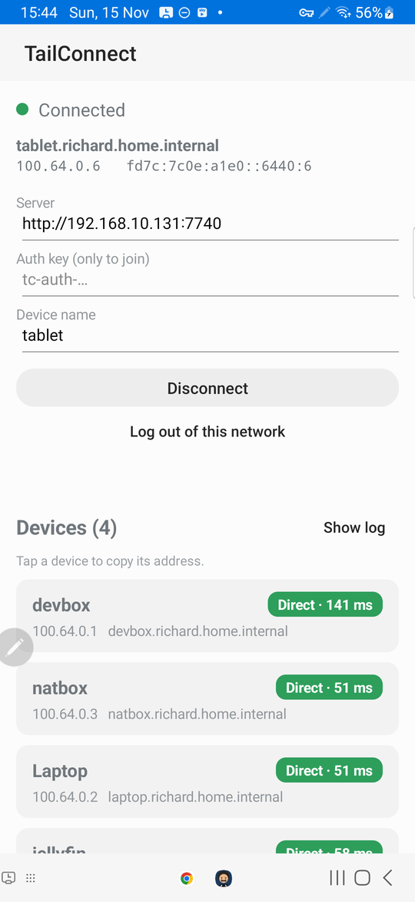

# Android

The TailConnect app puts an Android tablet or phone on your network, like any other device: it gets a `100.64.x.y` address and a name, reaches your machines directly or through the relay, and resolves MagicDNS names in every app.

- [Requirements](#requirements)
- [Build the app](#build-the-app)
- [Install it](#install-it)
- [Join and connect](#join-and-connect)
- [Join with a QR code](#join-with-a-qr-code)
- [Using it](#using-it)
- [How it works](#how-it-works)
- [Troubleshooting](#troubleshooting)

---

## Requirements

- Android 10 or later on a 64-bit ARM device (`arm64-v8a`; almost every phone and tablet from the last several years).
- A TailConnect server the device can reach, and an auth key for the account it joins (`sudo tc-control keys create -user NAME`).

The app isn't in an app store: you build it and install it yourself, over USB or by copying the file.

## Build the app

On a Linux machine with Go, a JDK (17 or later) and the Android SDK's command-line tools, with `build-tools` and one `platforms;android-NN` installed:

```sh
make android          # → android/build/tailconnect.apk
```

The build uses only the SDK's own tools (`aapt2`, `javac`, `d8`, `apksigner`): no Gradle, no NDK, no libraries. It looks for the JDK in `$JAVA_HOME` and the SDK in `$ANDROID_HOME`, defaulting to `~/Android/jdk` and `~/Android/Sdk`.

The first build creates a signing key in `~/.android/tailconnect-debug.keystore`. **Keep it.** Android only installs an update over the existing app if it is signed with the same key; with a new key, you must uninstall the app first, and the device joins again as a new machine.

## Install it

**Over USB.** On the device, turn on Developer options (Settings → About → Software information → tap Build number seven times), then USB debugging. Connect the cable, accept the prompt on the device, and run:

```sh
make android-install                  # builds, then installs on the connected device
```

`adb` comes with the SDK, in `platform-tools/`. `adb devices` should list the device as `device` (not `unauthorized`).

**Without USB.** Copy `tailconnect.apk` to the device (a cloud folder, a USB stick, e-mail), open it, and allow installing apps from that source when asked.

## Join and connect

Open TailConnect and fill in:

| Field | |
|---|---|
| Server | The URL your other devices use, e.g. `http://192.168.1.10:7740` or `https://vpn.example.com` ([which one?](network-setups.md)) |
| Auth key | `tc-auth-…`, needed only the first time. It isn't stored. |
| Device name | Its name on the network, e.g. `tablet` becomes `tablet.alice.home.internal` |

Tap **Connect**. The first time, Android asks to allow TailConnect to set up a VPN connection; tap **OK**. A key icon in the status bar shows the VPN is on.

## Join with a QR code

The quickest way. In the web portal, create an auth key (Auth keys → Generate key; tick **Reusable** for several devices). A QR code appears next to the key. On the Android device:

1. Open the camera app and point it at the code. (Any QR scanner works: Samsung's camera, Google Lens, the Quick Settings scanner.)
2. Tap the link it offers (`tailconnect://join?…`). TailConnect opens with the server and the key filled in, and says which server they're for.
3. Check the device name and tap **Connect**.

The app never connects from a link by itself: a link can come from anywhere, so you always see the server and decide. A key works once unless it's reusable; to join more devices with one code, make it reusable.

## Fill it in over USB

To fill the form in from your computer while the device is on USB (handy when setting up several devices):

```sh
adb shell am start -n tailconnect.android/.MainActivity \
    -e server http://192.168.1.10:7740 -e authkey tc-auth-… -e hostname tablet
```

You still tap Connect, and approve the VPN, on the device.

## Using it



- **The screen** shows this device's name and addresses, and your other devices, each with how it is reached: **Direct** (with the round-trip time), **Relay**, or **Idle** (no traffic lately). Tap a device to copy its address.
- **On a tablet** with room for it, the connection and the devices are side by side; **on a phone**, or a narrow tablet window (split screen), they are in one column. The layout follows rotation and window changes.
- **Names work in every app:** open `http://jellyfin:8096` in a browser, or enter `jellyfin` (or `100.64.0.5`) as the server in an app.
- **Disconnect** turns the VPN off. The device stays a member of the network; **Connect** brings it back without an auth key. **Log out of this network** removes it, so joining again needs a key.
- **Always on:** Settings → Connections → More connection settings → VPN → the gear next to TailConnect → Always-on VPN. Android then starts it at boot and after it was stopped.
- **Show log** shows the client's recent log, for troubleshooting.
- **Version and build**, at the bottom of the connection panel: for example `Version v0.6.0-dev · build 458951 (15 Nov 2026 17:11)`. The build number also says when the app was built. Include it when reporting a problem.

## How it works

- The app contains the same Go client as Linux devices (`tcd`), built for Android. It runs as a separate process of the app, and the app's screen controls it through the same local API that the `tc` command uses.
- Android only lets apps create VPN interfaces through its VPN service, so the app creates the interface and passes it to the client.
- **Only TailConnect traffic uses the VPN:** the tunnel's address ranges (`100.64.0.0/10` and `fd7c:7c0e:a1e0::/48`). Everything else, such as browsing and streaming from the internet, goes out as usual. The app's own traffic (WireGuard, the control server) is kept out of its VPN.
- **DNS:** while connected, the VPN's DNS server is MagicDNS (`100.100.100.100`), with your account's domain as a search domain, so short names work. Android sends it every lookup; it answers TailConnect names and passes everything else to the DNS servers of the network you're on (Wi-Fi or mobile data).
- **Network changes:** when you switch between Wi-Fi and mobile data, the app tells the client the new network's DNS servers, and lookups use them from the next query. If Android briefly reports a network without DNS servers while switching, the previous ones are kept.
- **Exit nodes:** the app can't use an [exit node](usage.md#exit-nodes) yet, or be one. It always uses the device's own internet connection.
- **Paths:** the app tells the client the device's addresses on the current network, since Android doesn't let apps read them directly. Devices on the same Wi-Fi then connect directly over it.

## Troubleshooting

| Symptom | What to do |
|---|---|
| "TailConnect needs permission to create a VPN" | You tapped Cancel on Android's VPN prompt. Tap Connect again and allow it. If another VPN app is set to always-on, turn that off first. |
| "Not joined: enter an auth key" | The device isn't a member yet, or was removed or logged out. Enter a new auth key and connect. |
| "invalid, expired or already-used auth key" | Keys work once unless they're reusable, and expire. Create a new one. If the device is already connected, you don't need a key at all: leave the field empty. The server logs each refused key's start (`journalctl -u tc-control \| grep refused`), to match against `tc-control keys list`. |
| The camera offers no link for the QR code | Use a scanner that opens links (Google Lens, the camera's QR mode). The code holds a `tailconnect://join` link, so the TailConnect app must be installed first. |
| Connects, but no devices are listed | The account has no other machines, or [access rules](usage.md#access-rules) hide them. Check in the web portal. |
| Devices show **Relay** on the same Wi-Fi | The Wi-Fi may isolate its clients (common on guest networks). It still works, more slowly. |
| Names don't resolve in an app | Check that the key icon is showing. Some apps cache DNS; restart the app. |
| TailConnect devices work, but no websites load | DNS: the client has no DNS servers for the current network. **Show log** says `dns: no upstream resolvers known`. Toggle Wi-Fi off and on so Android reports the network again, or update the app (versions from before 15 Nov 2026 kept stale DNS servers after a network change). |
| "INSTALL_FAILED_UPDATE_INCOMPATIBLE" when installing | The installed app was signed with another key. Uninstall it first (the device then joins again), or build with the original keystore. |
| Anything else | Tap **Show log**, or run `adb logcat -s TailConnect` with the device on USB. |
