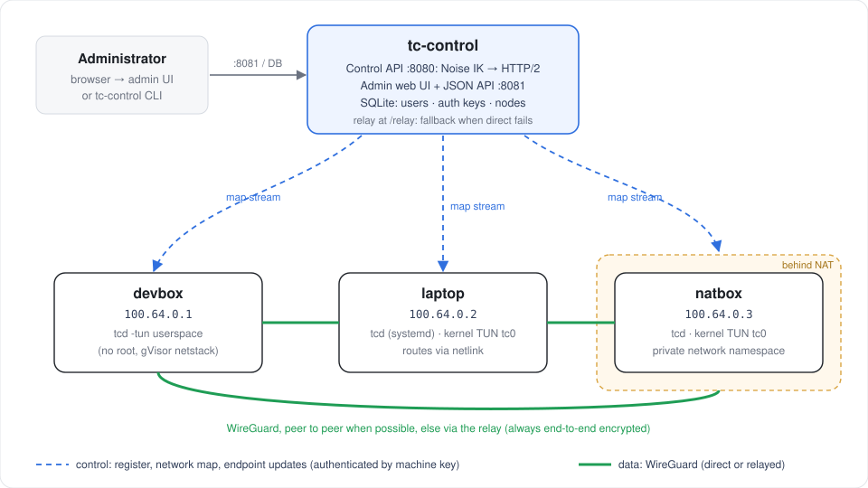

# How it works

TailConnect has a **control plane** and a **data plane**. The control server (`tc-control`) knows who is in the network and tells every device about its peers. It never carries their traffic. Devices (`tcd`) carry traffic between themselves over WireGuard: directly when they can, and through a relay when they can't.

- [Keys](#keys)
- [Joining](#joining)
- [The network map](#the-network-map)
- [Data plane](#data-plane)
- [NAT traversal](#nat-traversal)
- [Relays](#relays)
- [MagicDNS](#magicdns)
- [Resilience](#resilience)
- [Security model](#security-model)

---

## Keys

Each device generates three key pairs, all Curve25519, and keeps them in `/var/lib/tailconnect/state.json`:

| Key | Prefix | Used for |
|---|---|---|
| Machine key | `mkey:` | Identifies the device to the control server (Noise channel) |
| Node key | `nodekey:` | The device's WireGuard key. Peers and relays know the device by it. |
| Disco key | `discokey:` | Seals path-discovery messages between peers |

The server has its own machine key, plus a relay key, stored in its database. Private keys never leave the machine that made them.

## Joining

1. `tc up --server URL --authkey KEY` asks the local `tcd` to register.
2. `tcd` fetches the server's public key from `GET /key` and pins it. Over HTTPS this is authenticated; over plain HTTP it's trust on first use, unless you pass `--server-key`.
3. `tcd` opens a **Noise IK** channel to the server, carried in an HTTP Upgrade on `POST /machine/noise`. The handshake proves the device holds its machine key and the server holds the pinned key. Everything after that runs inside the channel, as HTTP/2 requests.
4. The device sends its node key, disco key, hostname and the auth key. The server checks the auth key, records the device, picks a unique name, and gives it the lowest free address in `100.64.0.0/10`, plus the matching IPv6 address.

A device can only act on its own registration: every request is tied to the machine key that made the Noise handshake. Knowing other devices' public keys gets an attacker nothing.

## The network map

After joining, `tcd` keeps one streaming request open. The server answers with a **network map**: this device, every peer (name, addresses, node and disco keys, reported endpoints, home relay), the DNS settings and the relay map. Whenever any of that changes, the server pushes a new map:
- a device joins, leaves or is renamed;
- a device reports new endpoints;
- an admin edits something, from the UI, the API or the CLI.

The server notices changes made by other processes, such as the CLI, through a change counter that database triggers keep up to date, which it checks every second. Keep-alives every 30 seconds keep the stream open through middleboxes.

## Data plane

`tcd` runs **wireguard-go** on a TUN device (`tc0`). Each network map is applied to WireGuard as a diff, so existing sessions survive updates. Every peer gets a /32 and a /128 route on `tc0` (tagged `proto 124`). Handshakes are started by traffic, so idle peers cost nothing, which matters on battery.

Underneath WireGuard sits **magicsock**, TailConnect's transport. WireGuard addresses each peer by its node key instead of an IP address, and magicsock picks the actual path for every packet:

- a **direct** UDP path, once one is confirmed;
- otherwise the peer's **relay**.

A direct path that stops answering for 3 seconds is dropped, and traffic moves to the relay. When the direct path comes back, traffic returns to it.

## NAT traversal

Most devices sit behind NAT, so they don't know the address others can reach them at. TailConnect finds direct paths like this:

1. **STUN.** Each device sends STUN requests from its WireGuard socket to the control server (UDP 3478) and to any other relay regions. The answer is the device's public address and port as seen from outside (its NAT mapping). It reports that to the control server, along with its local interface addresses. These are its **endpoints**, and they appear in every peer's network map.
2. **Disco pings.** When two devices start talking, each sends **disco** pings to all of the other's endpoints. Disco messages are sealed with NaCl box between the two devices' disco keys, so they can't be forged.
3. **CallMeMaybe.** At the same moment, each sends a *CallMeMaybe* message through the relay, asking the other side to ping back. Both sides now send at once, so each NAT sees outgoing traffic to the other's address and lets the replies in: a **hole is punched** in both NATs.
4. **Pong.** The first authenticated pong confirms the path and measures its latency, and traffic switches to it. Heartbeat pings every few seconds keep the path, and the NAT mapping, alive while the devices are active. The best path is re-evaluated as pongs come in.

**What works.** Ordinary home-router NATs keep the same public port for a socket and only let in replies to traffic sent out. These are punched on the first packet; `tests/e2e/nat.sh` checks this against routers configured like OpenWrt.

**What doesn't.** Some NATs can't be punched:
- NATs that pick a new public port for every destination ("symmetric" NAT, common on mobile carrier networks);
- Linux routers with no firewall on their WAN input, where stray packets create conntrack entries that make the NAT rewrite ports.

Peers behind these use the relay, which always works.

## Relays

A relay forwards WireGuard packets between devices that can't reach each other directly. Devices connect to their **home relay**: the region with the lowest STUN latency. They only switch to another region when it's at least 30% faster, to avoid flapping. A device sends packets for a peer to the peer's home relay, addressed by node key. The relay passes them on without being able to read them.

The connection is an HTTP Upgrade (`tailconnect-relay-v1`) on the relay's URL. The relay checks that the device owns its node key with a NaCl box challenge. The relay built into `tc-control` also refuses devices that aren't registered.

## MagicDNS

Each device runs a small DNS resolver at `100.100.100.100`, answering from the network map it already has:

- **A** and **AAAA** records for `<name>.<domain>`;
- **PTR** records for tunnel addresses;
- **NXDOMAIN** for unknown names under the domain.

There's no socket: `tcd` catches UDP packets to `100.100.100.100:53` as they enter the TUN device, before WireGuard sees them, and writes the answer straight back. Two consequences:
- it works the same on every platform;
- only the device itself can query it, because peers' packets arrive on the other side of WireGuard.

Then the OS is pointed at the resolver:
- **systemd-resolved:** `tc0` gets `100.100.100.100` as its DNS server, with the MagicDNS domain as a search domain, and routing domains for the reverse zones of `100.64.0.0/10` and the IPv6 range. resolved sends only those names there (split DNS).
- **resolv.conf:** the resolver becomes the only nameserver. It forwards other names to the original nameservers, one after another, with a 2-second timeout each. Answers larger than the client accepts come back truncated.

With `-dns-nameservers` on the server, devices send everything to MagicDNS (resolved's `~.` routing domain), and it forwards non-MagicDNS names to those servers.

## Resilience

- **Control server down.** Tunnels keep running on the last network map, and `tcd` reconnects with backoff. Devices that change networks meanwhile can still find each other through the relay, as long as the relay is up. The built-in relay is part of the control server, so for that case run a [separate relay](usage.md#relays).
- **Device removed by an admin.** Its tunnel is torn down, it goes to the logged-out state, and it must join again with an auth key.
- **Server moved.** `tc up --server NEW` keeps the registration when the new URL serves the same server key.

## Security model

- **Control channel.** Everything after `GET /key` runs inside Noise IK, and each request is tied to the client's machine key. Over plain HTTP, the server key is trusted on first use. Use HTTPS, or pin it with `--server-key`, to close that gap.
- **Secrets at rest.** The server stores only SHA-256 hashes of auth keys and the admin token. The database also holds the server's private machine key and relay key, so protect it and its backups.
- **Admin UI.**
  - HMAC-signed `SameSite=Strict` session cookies, valid for 12 hours. All sessions end when the token is replaced.
  - Writes are accepted only as JSON, and the request origin is checked.
  - A strict Content Security Policy.
  - It listens on loopback by default.
- **Path discovery.** Disco messages are sealed with NaCl box between the peers' disco keys, which are published in the network map. Discovery can't be spoofed to divert traffic.
- **Data.** WireGuard traffic is encrypted end to end between devices. Neither the control server nor the relays can read it.
- **Relays.** A device must prove it owns its node key before the relay accepts packets for it, so nobody can claim another device's key to intercept its packets. The built-in relay serves only registered devices; standalone `tc-relay` serves anyone who proves a key (`-allow-any`).
- **MagicDNS.** It answers only the local device and isn't reachable from peers, so it can't be used as an open resolver.
- **Local API.** `tc` talks to `tcd` over a Unix socket. The caller's UID (`SO_PEERCRED`) decides what it may do: status for anyone; up, down and logout for root.
- **Least privilege.** `tc-control` runs as an unprivileged dynamic user. `tcd` runs as root, limited to `CAP_NET_ADMIN` and `CAP_NET_RAW`, with a read-only system except `/etc/resolv.conf`.

Not yet: access rules between devices (every device can reach every other), device approval and key expiry. These are planned for milestone 8.
