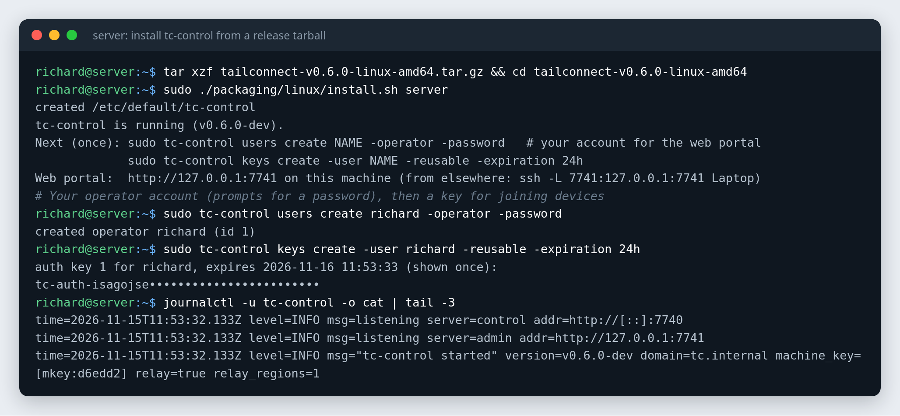
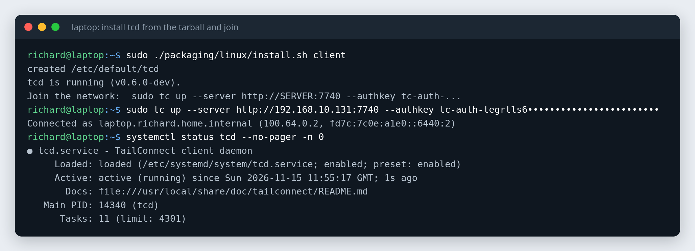

# Installation

This guide sets up a TailConnect network: one **control server** (`tc-control`) and any number of **devices** running the client daemon (`tcd`) and CLI (`tc`). It covers Linux servers and clients. For phones and tablets, see [Android](android.md); Windows is on the [roadmap](../README.md#roadmap).

**First decide where the server goes:** only on your LAN, on the internet, or at home but reachable from outside. [LAN and internet setups](network-setups.md) has the settings, ports and pitfalls for each.

- [Requirements](#requirements)
- [Get the software](#get-the-software)
- [Install the control server](#install-the-control-server)
- [Enable HTTPS](#enable-https)
- [Open the portal to other people](#open-the-portal-to-other-people)
- [Install clients](#install-clients)
- [Run without the installer](#run-without-the-installer)
- [Upgrade](#upgrade)
- [Move the server](#move-the-server)
- [Back up and restore](#back-up-and-restore)
- [Uninstall](#uninstall)

---

## Requirements

| | Control server | Devices |
|---|---|---|
| OS | Linux (any distribution) | Linux with `/dev/net/tun` (or [userspace mode](#without-root-userspace-mode)) |
| Service manager | systemd for the packaged unit; anything else [works by hand](#run-without-the-installer) | same |
| CPU | amd64 or arm64 tarballs; any architecture Go supports if you build it yourself | same |
| Resources | A few MB of RAM; a small VM or Raspberry Pi is plenty | same |
| Network | Reachable by every device on **TCP 7740** (control API and relay) and **UDP 3478** (STUN) | **UDP 41641** in and out for direct paths (optional: without it, traffic uses the relay) |
| DNS (optional) | | systemd-resolved, or a writable `/etc/resolv.conf`, for MagicDNS names |

To build from source you also need **Go 1.26** (an older Go with the default `GOTOOLCHAIN=auto` downloads it), and optionally `make`. All binaries are static (no cgo) and can be copied to other machines as they are.

## Get the software

**Release tarball.** Each tarball contains the four binaries, the systemd units, the installer and these docs:

```
tailconnect-v0.5.1-linux-amd64/
├── bin/          tc-control  tcd  tc  tc-relay
├── packaging/linux/
│   ├── install.sh
│   ├── tc-control.service   tc-control.default
│   └── tcd.service          tcd.default
├── README.md
└── docs/
```

**Build from source:**

```sh
git clone <this repo> && cd TailConnect
make build              # → bin/tc-control, bin/tcd, bin/tc, bin/tc-relay
make dist               # → dist/tailconnect-VERSION-linux-{amd64,arm64}.tar.gz
```

`make` stamps the version from `git describe`. To set it explicitly, use `make dist VERSION=v0.5.1`. Without `make`, run `go build -o bin/ ./cmd/...`, which reports its version as `dev`. To build for another architecture, run `make dist ARCHES="arm"` or `GOARCH=riscv64 go build -o bin/ ./cmd/...`.

The installer works from a source checkout too: it takes binaries from `bin/`.

---

## Install the control server

Pick a machine every device can reach: a small VPS, a home server, or one of the devices itself ([which setup?](network-setups.md#which-setup)). Then, from the tarball or source directory:

```sh
sudo ./packaging/linux/install.sh server
```



The installer:

- copies `tc-control` to `/usr/local/bin`;
- installs and starts the `tc-control` systemd unit. It runs as an unprivileged dynamic user, with its database in `/var/lib/tc-control/control.db`;
- creates `/etc/default/tc-control` for your options (the file is kept on upgrades).

Then, once, create your own account and a key for joining your devices:

```sh
sudo tc-control users create alice -operator -password             # prompts for a password (10+ characters)
sudo tc-control keys create -user alice -reusable -expiration 24h  # auth key for joining devices
```

The account name becomes part of your machines' names (`laptop.alice.tc.internal`), so it's lowercase letters, digits and `-`. `-operator` lets the account run the server in the web portal; other people's accounts are ordinary **tenants**, each with its own private network ([accounts and sign-up](usage.md#accounts-and-sign-up)). The auth key is printed **once** and stored only as a hash. `tc-control` on the server finds the installed database automatically, so no `-db` flag is needed, and you can run these commands whether or not the service is running.

### Choose your options

Edit `/etc/default/tc-control` and restart:

```sh
# /etc/default/tc-control
TC_CONTROL_ARGS="-domain home.internal -public-url http://vpn.example.com:7740"
```

```sh
sudo systemctl restart tc-control
```

The options you're most likely to want:

| Option | Why |
|---|---|
| `-domain home.internal` | MagicDNS names become `laptop.alice.home.internal` (default `tc.internal`). Changing it later renames everything. |
| `-signup MODE` | Who may create accounts in the portal: `off`, `approval` (default), `invite` or `open`. See [accounts and sign-up](usage.md#accounts-and-sign-up). |
| `-public-url URL` | The URL shown in the portal for clients to use |
| `-acme-domain NAME` | Automatic HTTPS from Let's Encrypt; see [Enable HTTPS](#enable-https) |
| `-listen :PORT` | A different control port (default `:7740`) |

All options are listed in the [configuration reference](configuration.md#tc-control-serve).

### Open the firewall

| Port | Protocol | Purpose |
|---|---|---|
| 7740 | TCP | Control API and built-in relay (clients connect here) |
| 3478 | UDP | STUN: clients learn their public address, needed for NAT traversal |
| 7741 | TCP | Web portal. It listens on 127.0.0.1 only by default; open it only if [other people use it](#open-the-portal-to-other-people). |

```sh
sudo ufw allow 7740/tcp && sudo ufw allow 3478/udp                     # Ubuntu/Debian with ufw
sudo firewall-cmd --permanent --add-port={7740/tcp,3478/udp} && sudo firewall-cmd --reload   # Fedora/RHEL
```

On a cloud VM, open the same ports in the provider's security group.

### Check it

```sh
systemctl status tc-control
curl http://localhost:7740/key        # {"Version":2,"MachineKey":"mkey:…"}
journalctl -u tc-control -f           # logs
```

The **web portal** is at `http://127.0.0.1:7741` on the server. From your workstation, run `ssh -L 7741:127.0.0.1:7741 server`, open `http://localhost:7741`, and sign in with your account. See [the web portal](usage.md#the-web-portal).

---

## Enable HTTPS

Over plain HTTP, the control channel is still encrypted and authenticated with Noise. However, the first time a client connects, it trusts whatever server key it is given ("trust on first use"). HTTPS removes that gap and lets you serve on port 443. HTTPS covers both the control API and the web portal. `tc-control` does HTTPS itself: no web server or proxy in front of it.

### Automatic certificates (Let's Encrypt)

`tc-control` gets a free certificate from Let's Encrypt and renews it by itself. You need:
- a DNS name pointing at the server, such as `vpn.example.com`;
- TCP port 443 reachable from the internet, so Let's Encrypt can check that the name is yours.

```sh
# /etc/default/tc-control
TC_CONTROL_ARGS="-listen :443 -acme-domain vpn.example.com -acme-email you@example.com"
```

```sh
sudo systemctl restart tc-control
curl https://vpn.example.com/key       # the first request fetches the certificate (a few seconds)
```

Clients then join with `--server https://vpn.example.com`. Open TCP 443 instead of 7740.

- **Another port than 443?** Let's Encrypt connects only to ports 443 and 80. Keep your port and also serve its checks on port 80: `-listen :7740 -acme-http-listen :80`. Port 80 then redirects everything else to HTTPS. Clients use `https://vpn.example.com:7740`.
- **Trying it out:** `-acme-staging` uses Let's Encrypt's test service, with generous limits but certificates that clients don't trust. Remove it, and the `acme` folder next to the database, for real certificates.
- **Where certificates live:** in `acme/` next to the database (`/var/lib/tc-control/acme`). They're renewed about a month before they expire, with no restart.
- **Several names:** `-acme-domain vpn.example.com,vpn.example.org`.

If it can't work (HTTPS on a port other than 443 with no `-acme-http-listen`), `tc-control` refuses to start and says why.

### Your own certificate

If you already have a certificate (from your own CA, or one renewed by other tooling), give `tc-control` the files. The packaged unit runs as a dynamic user that can't read other users' files, such as those under `/etc/letsencrypt`. So hand the files to the service with systemd **credentials**, using a drop-in:

```sh
sudo systemctl edit tc-control
```

```ini
[Service]
LoadCredential=cert.pem:/etc/letsencrypt/live/vpn.example.com/fullchain.pem
LoadCredential=key.pem:/etc/letsencrypt/live/vpn.example.com/privkey.pem
```

Then point `tc-control` at the copies systemd makes:

```sh
# /etc/default/tc-control
TC_CONTROL_ARGS="-listen :443 -public-url https://vpn.example.com -tls-cert /run/credentials/tc-control.service/cert.pem -tls-key /run/credentials/tc-control.service/key.pem"
```

- **Renewals:** systemd copies the credentials when the service starts, so restart `tc-control` after each renewal. Connected clients reconnect by themselves, and their tunnels keep running during the restart.
- **Private CA or self-signed certificates:** clients check the certificate against the system trust store. Add your CA there (`/usr/local/share/ca-certificates/` and `update-ca-certificates` on Debian/Ubuntu), then **restart `tcd`**, which reads the store at startup.
- **No certificate at all?** Pin the server key on each client instead: `sudo tc up --server http://… --server-key mkey:…`. The key is in the server log and in `curl http://SERVER:7740/key`.

---

## Open the portal to other people

If only you manage the server, keep the portal on 127.0.0.1 and reach it through SSH. If other people should sign up, add their own devices and share machines, they need to reach it, and since they type passwords into it, **over HTTPS only**:

1. Set up HTTPS as in [Enable HTTPS](#enable-https); the certificate covers the portal too.
2. Listen on a reachable address and choose who may sign up:
   ```sh
   # /etc/default/tc-control
   TC_CONTROL_ARGS="-listen :443 -acme-domain vpn.example.com -admin-listen :7741 -signup approval"
   ```
3. Open TCP 7741, restart (`sudo systemctl restart tc-control`), and send people `https://vpn.example.com:7741`.

With `-signup approval` (the default), new accounts wait in the Accounts tab until an operator approves them; `invite` needs a code you hand out; `off` hides sign-up. `tc-control` logs a warning if the portal listens on a non-loopback address without TLS. There's no e-mail on the server, so forgotten passwords are reset by an operator (Accounts → Reset password, or `tc-control users passwd NAME`).

---

## Install clients

On every device, from the tarball or source directory:

```sh
sudo ./packaging/linux/install.sh client
sudo tc up --server http://SERVER:7740 --authkey tc-auth-…
```



The installer copies `tcd` and `tc` to `/usr/local/bin`, then installs and starts the `tcd` unit. That unit runs as root with only `CAP_NET_ADMIN` and `CAP_NET_RAW`, and keeps its keys in `/var/lib/tailconnect`. It also creates `/etc/default/tcd` for options.

`tc up`:
- registers the device in the auth key's account;
- gives it a `100.64.x.y` address and a matching IPv6 address;
- configures the `tc0` interface, routes and DNS.

Options:

- `--hostname NAME` sets the device's name; the default is the OS hostname. An administrator can rename it later.
- You need the auth key only once. After a reboot or `tc down`, the device reconnects with a plain `sudo tc up`, or by itself when `tcd` starts.
- `--server-key mkey:…` pins the server key over plain HTTP (see [Enable HTTPS](#enable-https)).
- To use the key without putting it in shell history, run `sudo TC_AUTHKEY=tc-auth-… tc up --server …`.

Check it worked:

```sh
tc status          # this device, its peers and how each is reached
ping laptop        # MagicDNS: other devices by name
```

What the output means is explained in [Usage](usage.md#check-the-mesh).

### Client options

Edit `/etc/default/tcd` and run `sudo systemctl restart tcd`:

```sh
# /etc/default/tcd
TCD_ARGS="-dns off"         # e.g. leave the host's DNS alone
```

| Option | Default | |
|---|---|---|
| `-dns` | `auto` | How MagicDNS is wired into the OS: `auto`, `systemd-resolved`, `file`, `off` ([details](usage.md#magicdns)) |
| `-port` | `41641` | WireGuard UDP port. Falls back to a random port if it's in use. |
| `-tun` | `tc0` | Interface name |

### Without root: userspace mode

In containers, on shared machines, or anywhere you can't create a TUN device, run `tcd` as a normal user with an in-process network stack:

```sh
tcd -tun userspace -state ~/.local/share/tailconnect -socket "$XDG_RUNTIME_DIR/tcd.sock" &
tc --socket "$XDG_RUNTIME_DIR/tcd.sock" up --server http://SERVER:7740 --authkey tc-auth-…
```

The device joins the network and answers ping on its address. Other devices can reach it, and it shows up everywhere like any other device. Its own programs, however, can't use the tunnel, because no interface or route is added to the OS. Use this mode for test nodes and services built on the Go library, not for a workstation.

---

## Run without the installer

On systems without systemd, or to try TailConnect out in a terminal, run the binaries directly. They log to stderr.

```sh
# Server (any user; creates ./control.db)
tc-control users create alice -operator -password
tc-control keys create -user alice -reusable
tc-control serve -domain home.internal

# Client (root, for the TUN device and routes)
sudo tcd &                       # state in /var/lib/tailconnect, socket /run/tailconnect/tcd.sock
sudo tc up --server http://SERVER:7740 --authkey tc-auth-…
```

For other init systems, run `tc-control serve -db /var/lib/tc-control/control.db` and `tcd` as long-running services, restart them on failure, and send SIGTERM to stop them. `tcd` restores DNS settings and removes its routes when it stops.

---

## Upgrade

Run the installer again from the new release. It replaces the binaries and units, keeps `/etc/default/*` and `/var/lib/*`, and restarts the service:

```sh
sudo ./packaging/linux/install.sh server      # on the server
sudo ./packaging/linux/install.sh client      # on each device
```

- **Server restarts** don't drop tunnels. Devices keep talking to each other with the network map they have, and reconnect to the control server within seconds.
- **Client restarts** interrupt that device's traffic for a second or two. It keeps its address, name and keys.

**From 0.5 to 0.6** (multi-tenant):

- Upgrade the server first, then the clients. The database is migrated automatically on start; back it up first.
- Existing users become active tenant accounts without passwords. Give yourself an account to sign in to the portal: `sudo tc-control users passwd NAME` and `sudo tc-control users role NAME operator`. The admin token keeps working.
- Machine names gain the account: `laptop.home.internal` becomes `laptop.richard.home.internal`. Short names (`ping laptop`) keep working once clients run 0.6.
- Users' machines no longer see each other's: each user is now a separate network. Share machines between them where needed ([sharing](usage.md#sharing-a-machine)).

## Move the server

To give the server a new address, port or HTTPS while keeping its database, run on each device:

```sh
sudo tc up --server https://new-address
```

The device fetches the server key from the new URL. If it's the same server (same key), the device keeps its registration, address and name, and no auth key is needed. If the key is different, it's a different server: the device starts with a fresh identity and needs an auth key for that server.

**To new hardware** (say, from a VM to a Raspberry Pi): install the server on the new machine, stop both servers, copy the database across, start the new one, then run `tc up --server` on each device as above:

```sh
# on the new server, after install.sh server
sudo systemctl stop tc-control
sudo cp control.db /var/lib/private/tc-control/control.db      # copied from the old server's /var/lib/tc-control/
sudo cp /etc/default/tc-control.old /etc/default/tc-control    # or set the options again (-domain, -public-url, ...)
sudo systemctl start tc-control
```

Because the database holds the server's key, the devices keep their accounts, addresses and names. (The unit hands files copied in as root to the service's user when it starts.)

## Back up and restore

Everything the server knows is in `/var/lib/tc-control/control.db`: accounts, machines, shares, password and key hashes, and the server's own private keys. **Keep backups private.** A consistent copy:

```sh
sudo systemctl stop tc-control
sudo cp /var/lib/tc-control/control.db /root/tc-control-$(date +%F).db
sudo systemctl start tc-control
```

To restore, stop the service, copy the file back to the same path, and start it; the service takes ownership of the file when it starts. If the database is lost, the replacement server has a new key: on every device run `sudo tc logout` (which forgets the old key), then join again with `sudo tc up --server URL --authkey …`.

On a device, `/var/lib/tailconnect/state.json` holds its keys. If it's lost, the device simply joins again.

## Uninstall

```sh
sudo tc logout                                            # optional: remove the device from the network first
sudo ./packaging/linux/install.sh uninstall-client        # stops tcd, removes binaries and unit
sudo ./packaging/linux/install.sh uninstall-server        # on the server
```

Stopping `tcd` removes the interface and restores DNS. Keys, settings and the server database are kept, so a later install picks up where it left off. Add `--purge` to delete them as well (including `systemctl edit` drop-ins).
