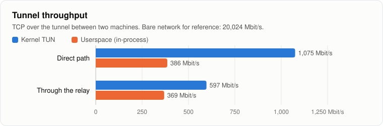
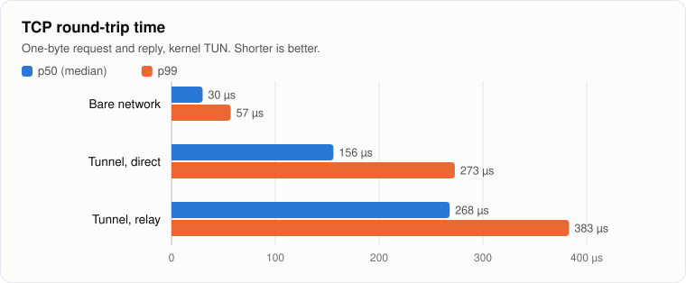

# Performance

How fast TailConnect moves traffic, how it scales on the server, and how to measure it yourself. All figures come from one machine (Intel i9-11950H laptop, 16 threads, Linux), so treat them as relative: your hardware and network will differ.

- [Throughput](#throughput)
- [Latency](#latency)
- [Server and packet paths](#server-and-packet-paths)
- [Known limits](#known-limits)
- [Measure it yourself](#measure-it-yourself)

---

## Throughput



| Path | Kernel TUN | Userspace (in-process) |
|---|---|---|
| Direct path | 928 Mbit/s | 374 Mbit/s |
| Through the relay | 613 Mbit/s | 353 Mbit/s |
| Bare network, no tunnel (reference) | 20,008 Mbit/s | |

- **Kernel TUN** is what a normal installation uses: `tests/perf/throughput.sh` runs two machines in network namespaces joined by a virtual Ethernet link, with real `tc0` interfaces and a single TCP stream.
- **Userspace** is `tcd -tun userspace` (gVisor's network stack inside the process), measured by `BenchmarkThroughput` between two daemons over loopback.
- The bare network is virtual Ethernet inside one host, so it's far faster than any real link; it shows the tunnel's own cost. The tunnel's direct-path limit here is close to 1 Gbit/s, so on faster links the tunnel, not the network, sets the ceiling (see [Known limits](#known-limits)).

## Latency



| Path | p50 (median) | p99 |
|---|---|---|
| Bare network | 30 µs | 57 µs |
| Tunnel, direct | 156 µs | 273 µs |
| Tunnel, relay | 268 µs | 383 µs |

One-byte request and reply over TCP, 2,000 round trips, kernel TUN. The tunnel adds about 0.13 ms on a direct path and 0.24 ms through the relay; on a real network, the distance between the machines (and to the relay) dominates.

## Server and packet paths

From `make bench`:

| What | Cost | Why it matters |
|---|---|---|
| Packet filter, no shares | 7 ns per packet | the cost when sharing isn't used |
| Packet filter, shares exist, packet from a same-account machine | 58 ns, no allocations | every packet pays this once any share exists |
| Packet filter, reply from a shared machine | ~340 ns | only a shared machine's traffic pays this |
| MagicDNS interception, ordinary packet | 63 ns | every packet the host sends |
| MagicDNS local answer (1,000 machines) | ~2.5 µs | about 400,000 lookups a second per core |
| Network map for a machine in a 1,000-machine account, built and encoded | ~0.3 ms | per machine, per change it can see |
| One change fanned out to all 1,000 machines of an account | ~0.36 s of server CPU | e.g. a laptop roaming to a new address |
| Relay policy check | ~165 ns per relayed packet | |
| Relay forwarding, one stream of 1,280-byte packets | ~130 MB/s | |
| Joining, with 2,000 machines in the account | ~3.4 ms per join | how fast a fleet can join |
| Password hash (argon2id) | ~55 ms | the portal runs four at once: about 70 sign-ins a second |

## Known limits

- **About 1 Gbit/s per stream through the tunnel.** magicsock hands WireGuard one packet per system call, and the profile is dominated by system calls and goroutine handoffs, not encryption (under 5% of CPU). Batched UDP I/O (`sendmmsg`/`recvmmsg`) and TUN offloads are the next step to raise it.
- **Maps are sent in full.** In a 1,000-machine account each map is about 340 KB, sent to every machine on every change it can see. Sending only the differences would make very large accounts cheap.
- **The relay forwards ~130 MB/s per stream** in the benchmark, limited by per-packet work (a system call and a channel hand-off per packet).

## Measure it yourself

```sh
make bench          # Go benchmarks (a few minutes)
make perf           # throughput and latency through real kernel TUN devices
make perf-budget    # fail if key operations exceed their budgets
```

- **`make bench`** runs the Go benchmarks: the packet filter, MagicDNS, relay forwarding, map building and encoding at scale, the relay policy, the database, password hashing, and TCP throughput and round trips between two real daemons (direct and relayed). Run one area with, for example, `go test -run '^$' -bench . ./internal/control/`.
- **`make perf`** runs [tests/perf/throughput.sh](../tests/perf/throughput.sh): two machines in network namespaces (no root needed with unprivileged user namespaces), measured with a small tool, [tests/perf/tput](../tests/perf/tput/main.go), on the bare network, the tunnel's direct path and the relay. `DURATION=10s RTTS=5000` makes longer runs; `MIN_DIRECT_MBPS=500 MIN_RELAY_MBPS=300` makes it fail below a throughput budget.
- **`make perf-budget`** runs a few benchmarks and fails if they exceed limits set about 10× above the figures here. They catch regressions in complexity rather than noise.
- **The charts** on this page are drawn by [tests/perf/charts.py](../tests/perf/charts.py) from the figures at its top: update them from a new run and run `python3 tests/perf/charts.py`.
