# The web portal

The portal is where you manage the network in a browser: machines, auth keys, access rules, sharing and, for operators, accounts. Everything in it can also be done with the [admin CLI](usage.md#admin-cli) or the [HTTP API](usage.md#admin-http-api).

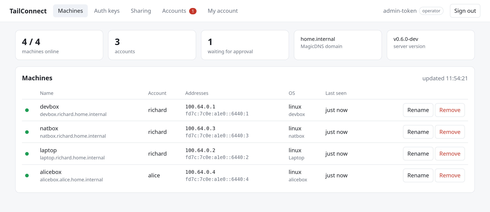

- [Open the portal](#open-the-portal)
- [Sign in and sign up](#sign-in-and-sign-up)
- [Machines](#machines)
- [Traffic](#traffic)
- [Auth keys](#auth-keys)
- [Access rules](#access-rules)
- [Sharing](#sharing)
- [Accounts and invites](#accounts-and-invites) (operators)
- [My account](#my-account)
- [Operators and tenants](#operators-and-tenants)
- [Settings that aren't in the portal](#settings-that-arent-in-the-portal)

---

## Open the portal

Open **port 7741 on the server** in a browser: `http://192.168.1.10:7741`, or `https://vpn.example.com:7741` on a server with HTTPS. The installer prints the address at the end.

- **Over plain HTTP**, passwords typed into the portal cross your network unencrypted. On a network you trust that may be fine. Otherwise turn on [HTTPS](lets-encrypt.md); the portal then uses the same certificate.
- **To keep the portal on the server only**, choose that in the installer (`sudo ./packaging/linux/install.sh server --reconfigure`), or set `-admin-listen 127.0.0.1:7741`. Then reach it through an SSH tunnel from your computer:
  ```sh
  ssh -L 7741:127.0.0.1:7741 you@server      # then open http://localhost:7741
  ```
- For other people to sign up, see [Open the portal to other people](installation.md#open-the-portal-to-other-people).

The portal follows your system's light or dark setting.

## Sign in and sign up

<table>
<tr>
<td width="50%">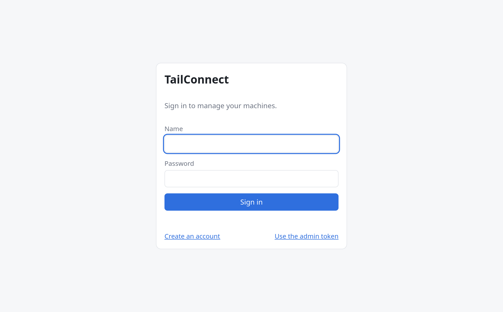<br><sub><b>Sign in</b> with your account name and password.</sub></td>
<td width="50%">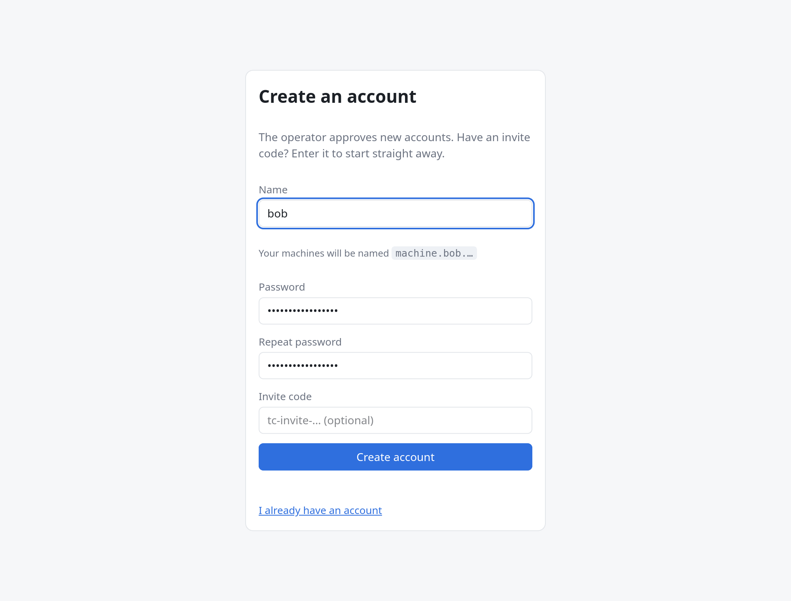<br><sub><b>Create an account</b>. The form shows what your machines will be called.</sub></td>
</tr>
</table>

- **Sessions** last 12 hours. Changing a password, role or status signs the account out everywhere else.
- **Create an account** appears only when the server's sign-up mode allows it (`-signup`; see [accounts and sign-up](usage.md#accounts-and-sign-up)):
  - with `approval` (the default), new accounts wait for an operator;
  - with `invite`, an invite code is needed;
  - with `open`, the account is active at once;
  - with `off`, the link isn't shown.
- **Account names** are 1–32 lowercase letters, digits or `-`. They're part of every machine name: `laptop.alice.home.internal`.
- **Passwords** are at least 10 characters. There's no e-mail on the server, so an operator resets forgotten ones.
- **Use the admin token** signs in as an operator without an account. It's for recovery, for example when no operator can sign in. Create one with `sudo tc-control admin-token`; scripts use the same token with the API.

**No one can sign in yet?** The installer creates your operator account on a new server. A server set up another way, or upgraded from an older version, may have no account with both a password and the operator role. Check, then fix it on the server:

```sh
sudo tc-control users list                        # PASSWORD column: yes/no; ROLE: operator/tenant
sudo tc-control users role richard operator       # make an existing account an operator
sudo tc-control users passwd richard              # give it a password (asked twice, at least 10 characters)
```

Or create a new operator account: `sudo tc-control users create NAME -operator -password`. Then sign in with that name and password.

## Machines

The machines of your account. An operator sees every account's machines, with an Account column.

| Column | Meaning |
|---|---|
| ● | Green: online (in contact within the last 5 minutes) |
| Name | The machine's name, its full MagicDNS name, its tags, *ephemeral* if it joined with an ephemeral key, and *exit node* if it is one |
| Addresses | Its IPv4 and IPv6 tunnel addresses |
| OS | Its operating system, and the device's own hostname |
| Last seen | When it last contacted the server |
| Traffic | Its current download and upload speed, and how much it has received and sent since its tunnel started. Click it for the breakdown per peer ([below](#traffic)). `–`: it hasn't reported any traffic. |
| Key | When its authorisation expires (*expires in 6 months*, *never expires*), *expired*, or *needs approval* |

| Button | What it does |
|---|---|
| **Approve** | Lets a machine that's waiting for approval join (see [My account](#my-account)). The tab shows how many are waiting. |
| **Never expire** / **Set expiry** | Lets the machine's key never expire, for example for servers that must not drop off; or gives it the server's normal key lifetime from now (`-key-expiry`, 180 days by default). |
| **Tags** | Sets the machine's tags, separated by commas (for example `server, db`), for [access rules](#access-rules). |
| **Exit node: off** / **Exit node: on** | Lets the machines in its account send their internet traffic through this machine, or stops it. Off for every machine until turned on; Linux machines only. Each machine then chooses whether to use it with `tc up --exit-node NAME` (see [Exit nodes](usage.md#exit-nodes)). |
| **Rename** | Changes its MagicDNS name. |
| **Remove** | Disconnects it and deletes it from the network. It needs a new auth key to join again. |

A tenant sees only their own machines:

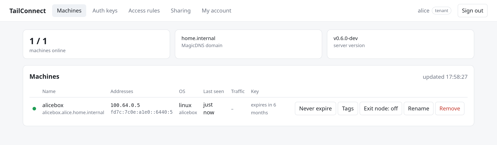

The cards along the top show machines online, accounts, machines waiting for approval (for operators), the MagicDNS domain, and the server's version. The tab refreshes every 10 seconds.

## Traffic

Click a machine's traffic to see whom it exchanges data with: the speed in each direction, and the totals, per peer.

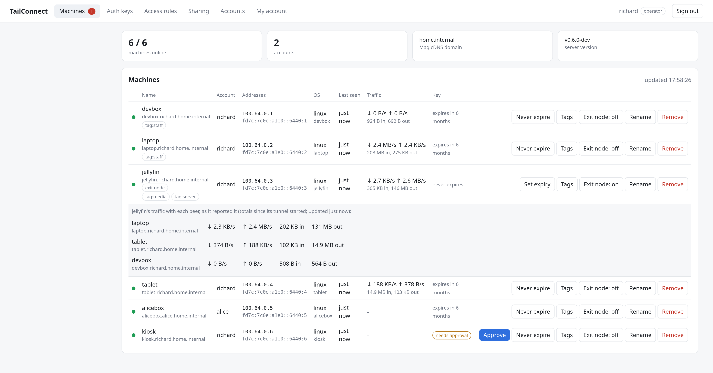

How the numbers come about:
- **Machines report them.** Traffic between your devices goes directly from one to the other, or through a relay, so the server never sees most of it. Every machine counts the bytes it exchanges with each peer, as `tc status` shows. It sends the counts to the server every 30 seconds while they change, over its encrypted control connection.
- **Speeds** are averages over the last 30 seconds. A machine whose traffic stops sends no more reports, so its speeds drop to zero after about a minute and a half.
- **Totals** count from when the machine's tunnel last started (when `tcd` started, or after `tc up`). They're not a lifetime total.
- **Each direction is from the machine's point of view:** ↓ is what it received, ↑ what it sent. The laptop's download from jellyfin is jellyfin's upload to the laptop.
- **The server keeps only the latest report**, in memory: nothing is stored on disk or kept as history. After a server restart, numbers return with the next reports.
- **`–`** means the machine hasn't reported anything: it's idle, offline, or runs an older client that doesn't report traffic.

Operators see every machine's traffic; tenants see their own machines'.

## Auth keys

A device joins with an auth key: `sudo tc up --server URL --authkey KEY`, or the Auth key field in the [Android app](android.md).

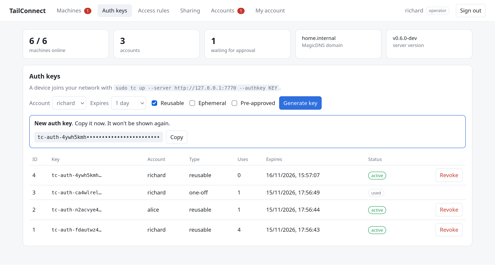

| Option | Meaning |
|---|---|
| Account | Operators only: which account the key joins machines to |
| Expires | How long the key can be used to join: 1 hour, 1 day, 7 days, 30 days or 90 days. Machines that joined stay; this isn't the machines' key expiry. |
| Reusable | It can join any number of devices until it expires. Otherwise it works once. |
| Ephemeral | Machines that join with it are removed automatically after being offline for a while (`-ephemeral-timeout`, 30 minutes by default). For short-lived machines, such as test VMs and CI. |
| Pre-approved | Machines that join with it skip the account's machine approval |

The new key is shown **once**: copy it then. The server keeps only a hash.

**The QR code** next to it holds the server's address and the key, as a `tailconnect://join` link. On an Android phone or tablet with the TailConnect app, point the camera at it and open the link: the app fills in the server and the key; you check the device name and tap Connect ([details](android.md#join-with-a-qr-code)). The address in the code is the server's public URL (`-public-url`, or the one the installer set). The table lists each key's uses and status (*active*, *used*, *expired* or *revoked*). **Revoke** stops a key from being used; machines that already joined with it stay.

## Access rules

By default, every machine in an account can reach every other. Once an account has a rule, **only what its rules allow** is reachable between its machines (replies always flow back). Operators can switch to any account with the Account selector.

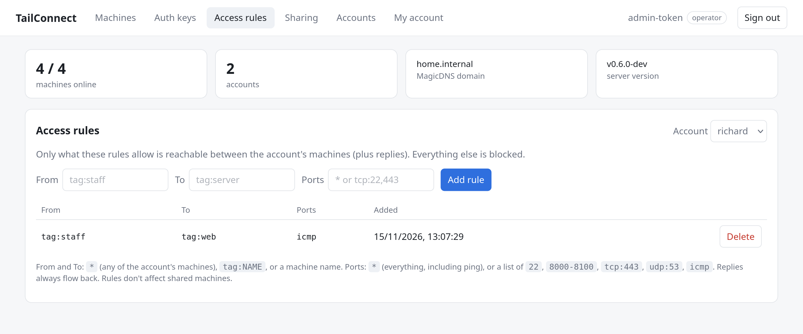

| Field | What to enter |
|---|---|
| From, To | `*` (any of the account's machines), `tag:NAME` (machines with that [tag](#machines)), or a machine name |
| Ports | `*` (everything, including ping), or a list such as `22`, `8000-8100`, `tcp:443`, `udp:53`, `icmp` |

The example above: machines tagged `staff` (devbox, laptop) may reach everything; others, such as the tablet, may reach nothing in the account; and the media server can't open connections to anyone. Rules don't affect [shared machines](#sharing). More in [Access rules](usage.md#access-rules).

## Sharing

Sharing lets another account's machines use one of yours, and it's one-way: they can connect to your machine; your machine can't connect to theirs.

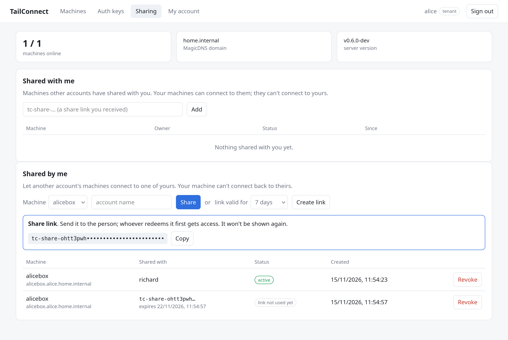

**Shared by me** (the owner):
- **Share** with an account by name. It takes effect once that account accepts.
- Or **Create link**, valid for 1, 7 or 30 days. Send it to the person; whoever redeems it first gets access. It's shown once.
- **Revoke** ends a share or an unused link.

**Shared with me** (the recipient):

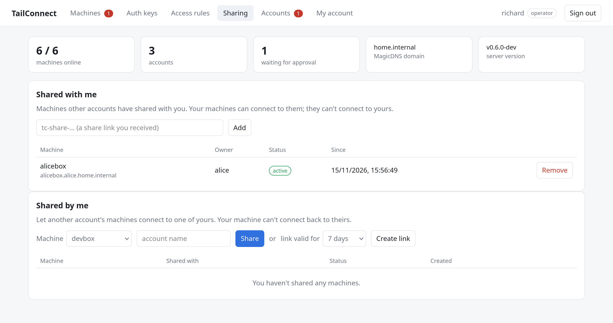

- Shares offered to your account appear here to **Accept**.
- To redeem a link you received, paste it and press **Add**.
- **Remove** stops using a shared machine.

Shared machines appear in your machines' network maps under their owner's name (`alicebox.alice`). More in [Sharing a machine](usage.md#sharing-a-machine).

## Accounts and invites

Operators only. Every account with its role, status, number of machines and creation date. Sign-ups waiting for approval come first, with a count on the tab.

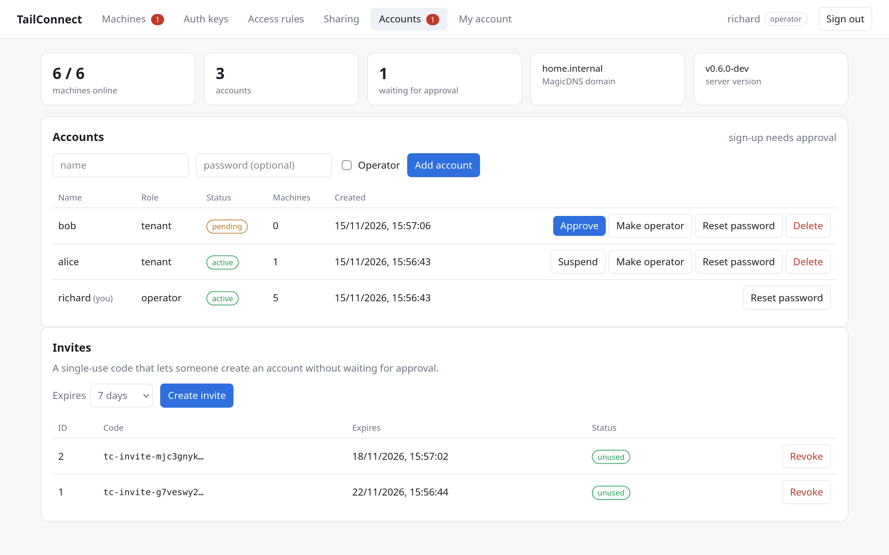

| | |
|---|---|
| **Add account** | Creates an account directly. With a password, it can sign in to the portal; without, it's only for machines (create keys for it). *Operator* makes it an operator. |
| **Approve** | Activates a pending sign-up |
| **Suspend** / **Reactivate** | Suspending signs the account out, cuts its machines off within a second (they keep their keys and show a notice in `tc status`), and stops its shares. Reactivating restores everything. |
| **Make operator** / **Make tenant** | Changes the role ([what operators can do](#operators-and-tenants)) |
| **Reset password** / **Set password** | Sets a new password, for example when someone forgot theirs |
| **Delete** | Removes the account with its machines, keys and shares, for good. Not possible on your own account, so you can't lock yourself out. |

The header shows the sign-up mode (`-signup`).

**Invites** let someone create an account without waiting for approval (in every sign-up mode except `off`). Create one valid for 1, 7 or 30 days and send the code; each works once. **Revoke** cancels an unused one.

## My account

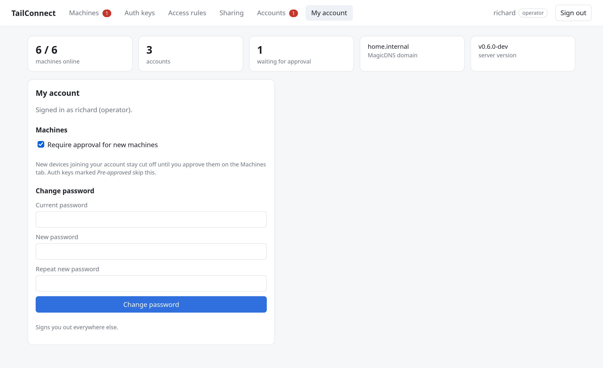

- **Require approval for new machines**: when on, devices joining your account stay cut off until you approve them on the Machines tab. Keys marked *Pre-approved* skip this. Off by default.
- **Change password**: needs your current password. It signs you out everywhere else.

## Operators and tenants

| | Tenant | Operator |
|---|---|---|
| Their own machines, keys, access rules, sharing | ✓ | ✓ |
| Every account's machines, keys and access rules | | ✓ |
| Accounts and invites | | ✓ |
| Change the server's settings | | from the server only (below) |

Each account is its own private network. A tenant never sees other accounts' machines, except through shares.

## Settings that aren't in the portal

The server's own settings are command-line options, set in `/etc/default/tc-control` on the server (then `sudo systemctl restart tc-control`). The ones that change what you see in the portal:

| Setting | Option | Default |
|---|---|---|
| Who may create accounts | `-signup off\|approval\|invite\|open` | `approval` |
| How long machines stay authorised | `-key-expiry 180d` (or `never`) | 180 days |
| When ephemeral machines are removed | `-ephemeral-timeout 30m` | 30 minutes |
| The MagicDNS domain | `-domain home.internal` | `tc.internal` |
| The URL shown for joining | `-public-url` | derived from `-listen` |
| Where the portal listens | `-admin-listen` | `:7741` (every address) |
| HTTPS | `-acme-domain NAME`, or `-tls-cert`/`-tls-key` | off |

All of them are in the [configuration reference](configuration.md#tc-control-serve). [Settings at a glance](configuration.md#settings-at-a-glance) lists every setting and where it's changed.
