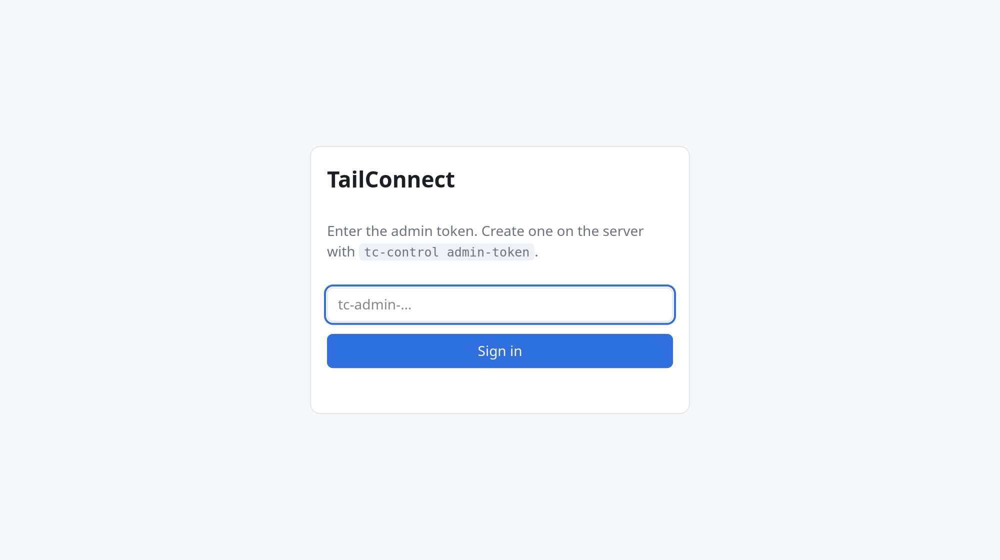
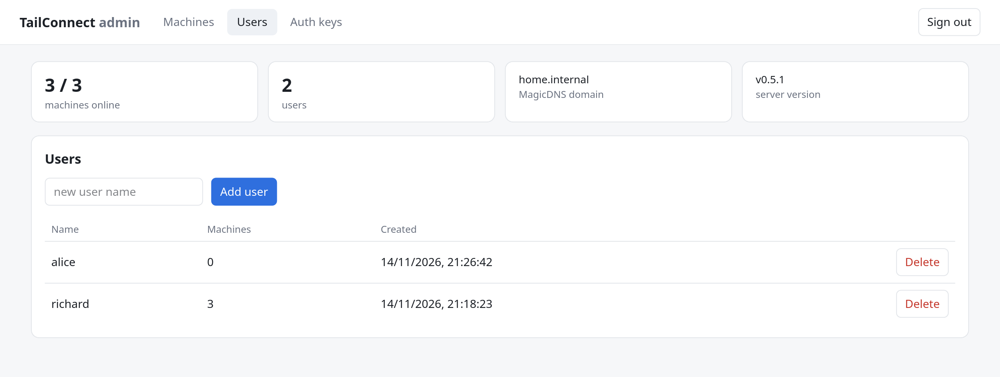
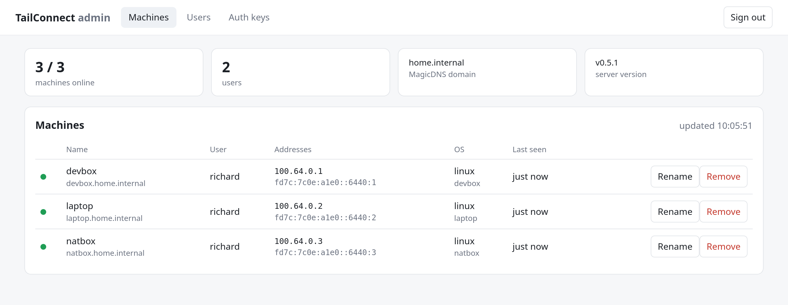
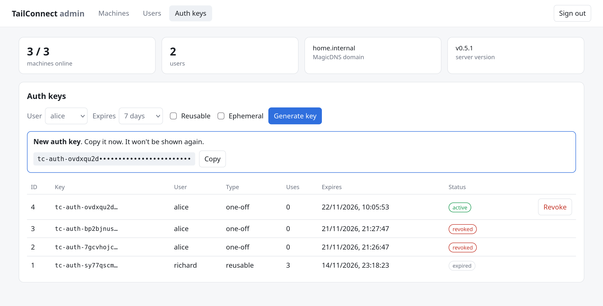
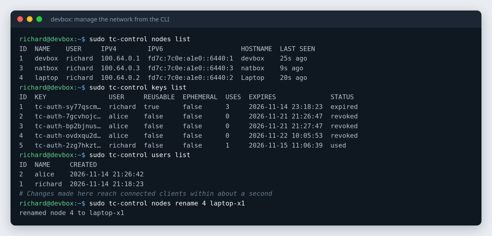
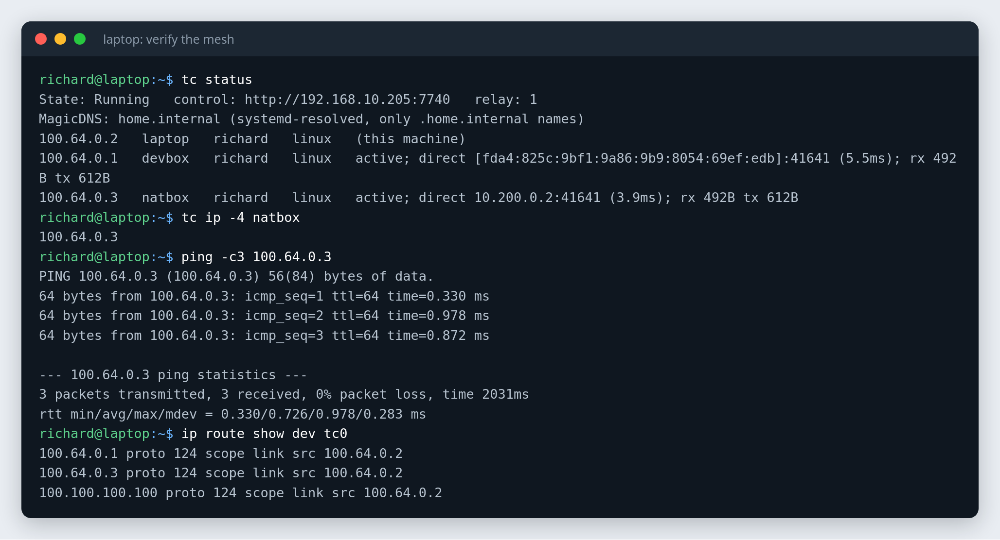

# Usage

How to run a TailConnect network once it's [installed](installation.md): adding and removing devices, the admin tools, the `tc` client, MagicDNS and relays.

- [Concepts](#concepts)
- [Common tasks](#common-tasks)
- [Admin web UI](#admin-web-ui)
- [Admin CLI](#admin-cli)
- [Admin HTTP API](#admin-http-api)
- [The `tc` client](#the-tc-client)
- [Check the mesh](#check-the-mesh)
- [MagicDNS](#magicdns)
- [Relays](#relays)

---

## Concepts

| | |
|---|---|
| **User** | An owner of devices, such as a person or a team. Every device belongs to one user. Deleting a user removes their devices and keys. |
| **Device** (machine, node) | A computer running `tcd`. It has a name, an IPv4 address from `100.64.0.0/10`, and a matching IPv6 address in `fd7c:7c0e:a1e0::/48`. The addresses stay the same for the device's lifetime. |
| **Auth key** (pre-auth key) | A `tc-auth-…` secret that lets a device join as a given user. It can be **single-use** or **reusable**, always **expires**, and can be **revoked**. Revoking a key or letting it expire stops new joins with it. Devices that already joined stay. A key marked **ephemeral** labels its devices as temporary. Automatic removal of ephemeral devices comes in milestone 8. |
| **Name** | Each device's DNS label (`laptop`), unique in the network and taken from its hostname. MagicDNS serves it as `laptop.<domain>`. If a name is taken, the next device gets `laptop-2`. |
| **Admin token** | The one `tc-admin-…` secret for the admin web UI and API. Creating a new one replaces the old one and signs everyone out. |

Every device can reach every other device. Per-user access rules (ACLs) are planned for milestone 8.

## Common tasks

| Task | Command (on the server) | Or in the admin UI |
|---|---|---|
| Add a person | `sudo tc-control users create bob` | Users → Add user |
| Let a device join | `sudo tc-control keys create -user bob`, then on the device `sudo tc up --server URL --authkey tc-auth-…` | Auth keys → Generate key |
| Join many devices (fleet, CI) | `sudo tc-control keys create -user ci -reusable -expiration 720h` | tick *Reusable* |
| Rename a device | `sudo tc-control nodes rename 4 build-server` | Machines → Rename |
| Remove a device | `sudo tc-control nodes delete 4` (or `sudo tc logout` on the device) | Machines → Remove |
| Stop a leaked key | `sudo tc-control keys revoke 7` | Auth keys → Revoke |
| Reset the admin token | `sudo tc-control admin-token` | |
| See who's online | `sudo tc-control nodes list` | Machines tab |

Changes reach every connected device within about a second. A removed device loses its tunnel immediately and has to join again with a new auth key.

---

## Admin web UI

The UI listens on `http://127.0.0.1:7741` on the server, and on loopback only by default. From your workstation:

```sh
ssh -L 7741:127.0.0.1:7741 you@server      # then open http://localhost:7741
```

Sign in with the admin token (`sudo tc-control admin-token` creates one). Sessions last 12 hours.

<table>
<tr>
<td width="50%"><br><sub><b>Sign in</b> with the <code>tc-admin-…</code> token.</sub></td>
<td width="50%"><br><sub><b>Users</b>: add users, or delete them with their devices and keys.</sub></td>
</tr>
</table>

**Machines** shows each device's online state (seen in the last 5 minutes), name and MagicDNS name, addresses, OS and last contact. **Rename** changes the MagicDNS name. **Remove** disconnects the device and deletes it from the network. The page refreshes every 10 seconds.



**Auth keys:** pick a user, an expiry and whether the key is reusable, then click *Generate key*. Copy the key straight away: it's shown only once. The table shows each key's uses and status: active, used, expired or revoked.



The UI follows your system's light or dark theme.

## Admin CLI

`tc-control` doubles as the admin CLI. It works directly on the database, so it works whether or not the server is running. Changes made with it reach clients within a second.



```
tc-control users create NAME | list | delete NAME
tc-control keys create -user NAME [-reusable] [-ephemeral] [-expiration 24h]
tc-control keys list [-user NAME] | revoke ID
tc-control nodes list [-user NAME] | delete ID | rename ID NEWNAME
tc-control admin-token
tc-control version
```

- `list` commands take `-json` for scripts.
- Flags can go before or after arguments.
- On an installed server, the database is found automatically (`/var/lib/tc-control/control.db`). Elsewhere, pass `-db PATH` or set `TC_CONTROL_DB`.
- Run it with `sudo` on an installed server: the database directory is readable only by root and the service.

## Admin HTTP API

The UI is built on a JSON API at the same address. Scripts authenticate with the admin token as a bearer token:

```sh
export TC_ADMIN_TOKEN=tc-admin-…
curl -H "Authorization: Bearer $TC_ADMIN_TOKEN" http://127.0.0.1:7741/api/v1/nodes
```

| Method and path | Body | Result |
|---|---|---|
| `GET /api/v1/status` | | Server version, domain, control URL, machine key, user/device/online counts |
| `GET /api/v1/users` | | `[{name, created, nodes}]` |
| `POST /api/v1/users` | `{"name": "bob"}` | the new user |
| `DELETE /api/v1/users/{name}` | | 204; also removes their devices and keys |
| `GET /api/v1/keys` | | `[{id, prefix, user, reusable, ephemeral, uses, created, expires, revoked, usable}]` |
| `POST /api/v1/keys` | `{"user": "bob", "reusable": true, "ephemeral": false, "ttl": "24h"}` | 201 `{"key": "tc-auth-…", "info": {…}}`. The TTL can be up to 2160h (90 days). |
| `DELETE /api/v1/keys/{id}` | | revokes the key |
| `GET /api/v1/nodes` | | `[{id, name, fqdn, user, hostname, os, ipv4, ipv6, endpoints, nodeKey, ephemeral, created, lastSeen, online}]` |
| `POST /api/v1/nodes/{id}/rename` | `{"name": "build-server"}` | renames |
| `DELETE /api/v1/nodes/{id}` | | removes the device |

Write requests must send `Content-Type: application/json`. Errors come back as `{"error": "…"}` with a 4xx or 5xx status. For example, to create a key:

```sh
curl -H "Authorization: Bearer $TC_ADMIN_TOKEN" -H 'Content-Type: application/json' \
     -d '{"user":"bob","ttl":"1h"}' http://127.0.0.1:7741/api/v1/keys
```

---

## The `tc` client

`tc` talks to the local `tcd` over a Unix socket. Anyone can run `tc status`, `tc ip` and `tc version`. `up`, `down` and `logout` need root.

| Command | What it does |
|---|---|
| `tc up --server URL --authkey KEY [--hostname NAME] [--server-key mkey:…]` | Join a network the first time. |
| `tc up` | Reconnect after `tc down`. Also: `--server NEW` after the server moves; `--authkey` to re-register, e.g. after the device was removed. |
| `tc down` | Disconnect. The tunnel, routes and DNS settings are removed, and the device stays registered. It stays down across reboots until `tc up`. |
| `tc status [--json]` | This device, its peers, and how each peer is reached |
| `tc ip [-4\|-6] [PEER]` | This device's addresses, or a peer's (by name or short name) |
| `tc logout` | Leave the network: tells the server to delete this device and forgets its keys |
| `tc version` | Client version |

Global option: `--socket PATH` (or `$TC_SOCKET`), for a `tcd` running with a non-default socket, such as [userspace mode](installation.md#without-root-userspace-mode).

## Check the mesh



`tc status` prints a header, then one line per device:

```
State: Running   control: http://192.168.10.205:7740   relay: 1
MagicDNS: home.internal (systemd-resolved, only .home.internal names)
100.64.0.2   laptop   richard   linux   (this machine)
100.64.0.1   devbox   richard   linux   active; direct 192.168.10.205:41641 (5.5ms); rx 492B tx 612B
100.64.0.3   natbox   richard   linux   active; direct 10.200.0.2:41641 (3.9ms); rx 492B tx 612B
```

| You see | Meaning |
|---|---|
| `State: Running` | Connected to the control server and the tunnel is up. `Starting` means connecting; a `Warning:` line below says why if it takes a while. The tunnel keeps working on its last map even while control is unreachable. |
| `relay: 1` | This device's home relay region, used to reach it when no direct path exists |
| `active` / `idle` | Whether a WireGuard handshake with that peer completed in the last 3 minutes. Idle peers cost nothing, and connect on the first packet. |
| `direct ADDR (N ms)` | Packets go straight to ADDR, often the peer's NAT-mapped public address, with the measured round-trip time |
| `relay N` | Packets currently go through relay region N. That's normal for a second or two while a direct path is found, and permanent when a firewall or NAT blocks direct UDP (see [Troubleshooting](troubleshooting.md#peers-stay-on-relay)). |
| `rx` / `tx` | Bytes received and sent through the tunnel to that peer |

`ip route show dev tc0` shows a route per peer (tagged `proto 124`, so they're easy to tell from your own routes), plus one for `100.100.100.100`, the MagicDNS resolver.

---

## MagicDNS

Every device is reachable as `<name>.<domain>`. The domain is set by `-domain` on the server, `tc.internal` by default. The short name works too, thanks to the search domain: `ssh laptop`, `ping natbox`. Reverse lookups of tunnel addresses return names, so logs and `ping` show `natbox.home.internal` instead of a bare IP. When a device is renamed, the new name works everywhere within a few seconds.


Each device runs its own resolver at `100.100.100.100`, answering from the network map it already has, and `tcd` points the OS at it. How depends on `tcd -dns` (set in `/etc/default/tcd`):

| Mode | When `auto` picks it | What it does |
|---|---|---|
| `systemd-resolved` | `/etc/resolv.conf` points at resolved's stub (127.0.0.53): Ubuntu, Fedora, Mint, Debian with resolved | Split DNS on the `tc0` link: only `.<domain>` names and reverse lookups of tunnel addresses go to MagicDNS. Everything else keeps using your normal DNS. |
| `file` | any other `/etc/resolv.conf` | Rewrites `resolv.conf` to use `100.100.100.100`, adding the search domain and keeping your options. MagicDNS forwards other names to the nameservers that were there before. The original comes back when `tcd` stops, or at the next start after a crash. |
| `off` | userspace mode, or `tcd` running in a network namespace other than the host's | Leaves the OS alone. You can still query the resolver directly: `dig @100.100.100.100 laptop.tc.internal`. |

The `MagicDNS:` line in `tc status` shows the mode in use, and any error setting it up.

**Send all DNS through the tunnel.** To make every device use particular resolvers (say, a filtering DNS service), start the server with `-dns-nameservers 1.1.1.1,9.9.9.9`. Devices then send every query to MagicDNS: it answers `.<domain>` names itself and forwards everything else to those servers.

**Turn it off** for the whole network with `-magic-dns=false` on the server, or on one device with `-dns off`.

Current limits:
- Queries are UDP only. A forwarded answer too big for UDP (rare, over about 1200 bytes) comes back truncated, and the client's retry over TCP fails.
- If systemd-resolved restarts while `tcd` is running, the link settings come back with the next network map change, or with `sudo systemctl restart tcd`.

---

## Relays

When two devices can't reach each other directly (blocked UDP, strict NATs), their WireGuard packets go through a **relay**. The relay forwards packets that are already encrypted, so it can't read them. Each device keeps a connection to its **home relay**: the region with the lowest latency, measured with STUN.

**The built-in relay.** `tc-control` serves a relay at `/relay` on its control port, plus a STUN server on UDP 3478. It serves only registered devices. For most networks, that's all you need.

**More relays.** If your devices are spread across the world, run `tc-relay` close to them so relayed traffic doesn't cross the globe twice:

```sh
tc-relay -allow-any -listen :7742 -stun-listen :3478 -public-url http://relay-eu.example.com:7742/relay
```

It prints an example relay map. Save the regions as JSON on the control server, and start `tc-control` with `-relay-map /etc/tailconnect/relays.json`:

```json
{
  "Regions": [
    {"ID": 1, "Code": "home", "Name": "tc-control (embedded)",
     "Nodes": [{"Name": "1a", "URL": "/relay", "STUNPort": 3478}]},
    {"ID": 2, "Code": "eu", "Name": "Frankfurt",
     "Nodes": [{"Name": "2a", "URL": "http://relay-eu.example.com:7742/relay", "STUNPort": 3478}]}
  ]
}
```

- A relative URL such as `/relay` means the relay built into the control server. List it if you keep `-relay` on (the default).
- `STUNPort` is the region's STUN server (`0` for none). `HostName` overrides the STUN host, which defaults to the URL's host.
- Devices pick the region with the lowest STUN latency as their home. They only switch when another region is at least 30% faster.

`tc-relay` requires `-allow-any`. It can't check registrations with the control server yet, so it relays for any device that proves it owns its key. Traffic stays end-to-end encrypted, but anyone who can reach the relay can use its bandwidth. Use `-tls-cert` and `-tls-key` for HTTPS. All options are in the [configuration reference](configuration.md#tc-relay).
