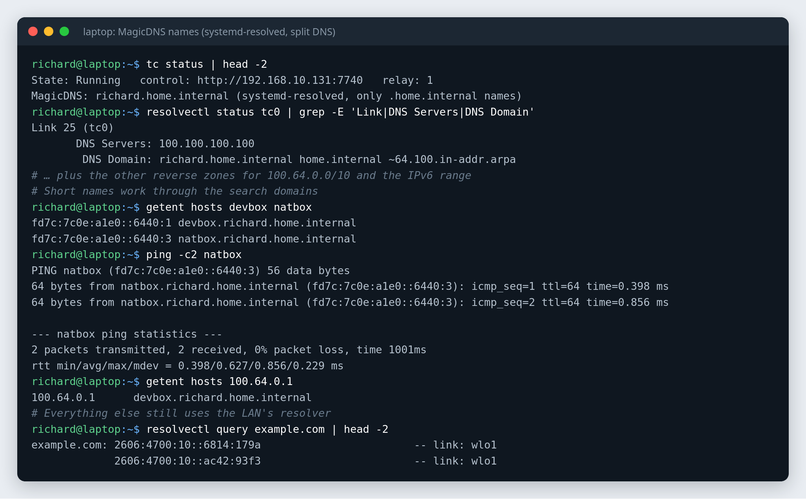

# Usage

How to run a TailConnect server once it's [installed](installation.md): accounts and sign-up, adding devices, sharing machines between accounts, the web portal and admin tools, the `tc` client, MagicDNS, relays and monitoring.

- [Concepts](#concepts)
- [Common tasks](#common-tasks)
- [Accounts and sign-up](#accounts-and-sign-up)
- [Access rules](#access-rules)
- [Sharing a machine](#sharing-a-machine)
- [Exit nodes](#exit-nodes)
- [The web portal](#the-web-portal)
- [Admin CLI](#admin-cli)
- [Admin HTTP API](#admin-http-api)
- [The `tc` client](#the-tc-client)
- [Check the mesh](#check-the-mesh)
- [MagicDNS](#magicdns)
- [Relays](#relays)
- [Monitoring](#monitoring)

---

## Concepts

| | |
|---|---|
| **Account** (tenant) | One login (name and password) with its own private network. An account's machines see and reach each other, and nothing of other accounts', unless a machine is shared. The name is part of every machine's DNS name, so it's limited to lowercase letters, digits and `-`. |
| **Operator** | An account that also runs the server: it sees every account and machine, approves sign-ups, suspends accounts and issues invites. As a member of the network, an operator's own machines are as isolated as anyone else's. |
| **Status** | `active`, `pending` (signed up, waiting for an operator's approval) or `suspended`. Pending and suspended accounts can't sign in, and their machines are cut off from the network until the account is active again. |
| **Machine** (device, node) | A computer running `tcd`, belonging to one account. It gets an IPv4 address from `100.64.0.0/10` and a matching IPv6 address, for its lifetime. Its name, taken from its hostname, is unique within the account: two accounts can both have a `laptop`. |
| **Name** | `machine.account.domain`, for example `laptop.alice.tc.internal`. Within an account, the short name (`laptop`) works too. |
| **Auth key** | A `tc-auth-…` secret that lets a device join an account. It can be **single-use** or **reusable**, always **expires**, and can be **revoked**. Revoking a key or letting it expire stops new joins; machines that already joined stay. An **ephemeral** key's machines are removed automatically once they've been offline for 30 minutes (CI runners, short-lived containers). A **pre-approved** key's machines skip the account's machine approval. |
| **Key expiry** | Each machine's authorisation lasts 180 days by default (the server's `-key-expiry`). After that it's cut off, with a notice, until someone re-authenticates it with `sudo tc up --authkey KEY`, which renews it. The owner or an operator can set a machine to **never expire** (servers that must not drop off). Machines that joined before expiry existed never expire. |
| **Machine approval** | An account can require approval for new machines (My account → *Require approval for new machines*). A new machine then stays cut off, with a notice, until the owner or an operator clicks **Approve**. |
| **Share** | Permission for another account's machines to connect to one of your machines. It's **one-way**: the shared machine can only reply, never open connections back. A share by name is **pending** until the recipient accepts it; a **share link** is accepted by whoever redeems it first. |
| **Invite** | A single-use `tc-invite-…` code from an operator that lets someone create an account without waiting for approval. |
| **Admin token** | A `tc-admin-…` secret for scripts (the HTTP API) and as a break-glass operator sign-in. Creating a new one replaces the old one. |
| **Tag** | A label on a machine, such as `server` or `db`, used by access rules (`tag:server`). |
| **Access rule** | *from → to on ports*, within one account. An account with no rules lets every machine reach every other; once it has rules, only what they allow is reachable ([Access rules](#access-rules)). |

## Common tasks

| Task | In the web portal | On the server |
|---|---|---|
| Create your operator account | | `sudo tc-control users create NAME -operator -password` |
| Let someone in | Accounts → Add account, or **Approve** their sign-up, or create an **invite** | `sudo tc-control users create bob -password`, `… users approve bob`, `… invites create` |
| Join a device | Auth keys → Generate key, then on the device `sudo tc up --server URL --authkey tc-auth-…` | `sudo tc-control keys create -user bob` |
| Join many devices (fleet, CI) | tick *Reusable* | `… keys create -user ci -reusable -expiration 720h` |
| Share a machine with another account | Sharing → Share (by name) or Create link | `sudo tc-control shares create NODE_ID ACCOUNT` |
| Accept a share | Sharing → Accept, or paste a link under "Shared with me" | `sudo tc-control shares accept ID` |
| End a share | Sharing → Revoke (owner) or Remove (recipient) | `sudo tc-control shares revoke ID` |
| Limit which machines reach which | Machines → Tags, then Access rules → Add rule | `… nodes tag 4 server`, `… rules add -user bob tag:staff tag:server tcp:22,443` |
| Rename a machine | Machines → Rename | `sudo tc-control nodes rename 4 build-server` |
| Remove a machine | Machines → Remove (or `sudo tc logout` on it) | `sudo tc-control nodes delete 4` |
| Cut an account off | Accounts → Suspend | `sudo tc-control users suspend bob` |
| Reset a forgotten password | Accounts → Reset password | `sudo tc-control users passwd bob` |
| Approve a new machine | Machines → Approve | `sudo tc-control nodes approve 4` |
| Require approval for new machines | My account | `sudo tc-control users machine-approval bob on` |
| Make a machine an exit node | Machines → **Exit node: off** (Linux machines) | `sudo tc-control nodes exit-node 4 on` |
| Send a machine's internet traffic through an exit node | | on the machine: `sudo tc up --exit-node NAME` (`--exit-node ""` stops) |
| Keep a server from ever expiring | Machines → Never expire | `sudo tc-control nodes expiry 4 never` |
| Renew an expired machine | | on the machine: `sudo tc up --authkey tc-auth-…` |
| Stop a leaked key | Auth keys → Revoke | `sudo tc-control keys revoke 7` |

Changes reach every connected machine within about a second.

---

## Accounts and sign-up

**Your own account.** Create the first operator account on the server; the password is prompted for (or read from standard input in scripts):

```sh
sudo tc-control users create richard -operator -password
```

**Other people's accounts.** Either create them yourself (Accounts → Add account, or `tc-control users create NAME -password`), or let people sign up in the portal. The server's `-signup` option decides who can:

| `-signup` | What happens when someone fills in *Create an account* |
|---|---|
| `off` | The link isn't shown; only operators create accounts. |
| `approval` (default) | The account is created **pending**. An operator approves it (Accounts → Approve, or `tc-control users approve NAME`). |
| `invite` | An invite code is required; the account is active straight away. |
| `open` | The account is active straight away. Only for servers that trusted people can reach. |

In every mode except `off`, a valid invite code skips approval. Operators create invites in the portal (Accounts → Create invite) or with `tc-control invites create`; each works once, and expires (7 days by default).

<table>
<tr>
<td width="50%"><br><sub><b>Sign in</b> with your account. <i>Create an account</i> appears when sign-up is on.</sub></td>
<td width="50%"><br><sub><b>Sign up</b>. The form shows what the machines will be called.</sub></td>
</tr>
</table>

For sign-up to be useful, people must be able to reach the portal: see [Open the portal to other people](installation.md#open-the-portal-to-other-people).

**Suspending** an account (Accounts → Suspend, or `tc-control users suspend NAME`) signs it out, cuts its machines off within a second (they keep their keys and show `Notice: … account is suspended` in `tc status`), and stops its shares. **Reactivating** restores everything without touching the machines. **Deleting** an account removes its machines, keys and shares for good.

Passwords are at least 10 characters. Changing a password, the role or the status signs the account out everywhere else.

---

## Access rules

By default every machine of an account can reach every other, on any port. Access rules narrow that down, for example: laptops may reach the servers on SSH and HTTPS, and nothing else.

1. **Tag the machines** (Machines → Tags, or `tc-control nodes tag ID server,db`): `staff` for the laptops, `server` for the servers.
2. **Add rules** (Access rules → Add rule, or `tc-control rules add`). Each rule is *from → to on ports*:

| Field | Values |
|---|---|
| From, To | `*` (any of the account's machines), `tag:NAME`, or a machine name |
| Ports | `*` (everything, including ping), or a comma-separated list of `22`, `8000-8100` (TCP and UDP), `tcp:443`, `udp:53`, `icmp` (ping) |


How they behave:

- **No rules = everything allowed.** The first rule switches the account to *only what the rules allow*; deleting the last rule switches back. The portal asks before either.
- Rules only add permissions, and they're one-way: `tag:staff → tag:server on tcp:22` lets laptops open SSH to servers, not the reverse. Replies always flow back, so the SSH session works.
- Machines that no rule lets talk in either direction don't see each other at all (not in `tc status`, no name, no relay).
- In `tc status`, a limited peer shows what it may open on this machine: `rules: can open tcp:22,443 here`, or `rules: can't open connections here`.
- Rules apply within the account. They don't change [shares](#sharing-a-machine): a machine shared with you is reachable as the share says.
- Changes take effect on every machine within a second.

Rules are enforced by each receiving machine's packet filter, the same one that makes sharing one-way ([how](how-it-works.md#access-rules-and-the-packet-filter)).

---

## Sharing a machine

Share a machine when someone in another account should be able to use it (a file server, a build machine, a printer host), without joining your network or seeing your other machines.


1. **Offer it.** In Sharing → *Shared by me*, pick the machine and either type the other account's name and click **Share**, or click **Create link** and send the `tc-share-…` code (single use, valid for the time you pick).
2. **They accept.** A share by name appears under *Shared with me* in their portal, with a badge on the Sharing tab; they click **Accept**. A link is accepted by pasting it into *Shared with me* and clicking **Add**.
3. **It's in effect.** Within a second, all of their machines can connect to yours, by name: `nas.alice` (short for `nas.alice.tc.internal`).

| | Their machines → your shared machine | Your shared machine → their machines | Your other machines |
|---|---|---|---|
| Visible | yes | yes, so replies work | no |
| Can connect | **yes** | **no**: only replies to their connections | no |

On the recipient's machines, `tc status` shows the machine as `shared with you`; on your shared machine, their machines show as `has access to this machine`:


**Ending a share.** The owner clicks **Revoke**, the recipient **Remove** (or **Decline** while it's pending), or an operator runs `tc-control shares revoke ID`. Access ends within a second. Shares also end when the machine is deleted or moves to another account, and stop working while either account is suspended.

**Both ways.** If two accounts each share a machine with the other, each may open connections to the other's shared machine. That's how to get a two-way link between two specific machines.

The one-way rule is enforced by the packet filter on each recipient machine, so even a compromised shared machine can't open connections into the other account ([how](how-it-works.md#sharing-and-the-packet-filter)).

---

## Exit nodes

An exit node is a machine in your account that other machines in your account can send **all** their internet traffic through, for example to browse from a café as if from home. Websites then see the exit node's public address.

Every machine's exit node role is **off** until you turn it on, and each machine chooses for itself whether to use one.

1. **Turn it on.** In the portal's Machines tab, click **Exit node: off** on a Linux machine (or run `tc-control nodes exit-node ID on`). Within a second, that machine enables IP forwarding and NAT for traffic from the tunnel. Its `tc status` says `Exit node: this machine forwards internet traffic for its account`.
2. **Use it.** On another Linux machine: `sudo tc up --exit-node NAME` (a short name, MagicDNS name, hostname or tunnel IP). `tc status` shows `Exit node: internet traffic goes through NAME`, and lists it as `exit node (in use)`.
3. **Stop using it.** `sudo tc up --exit-node ""`. The choice is remembered across restarts and reboots until changed.

What goes where while a machine uses an exit node:

| Traffic | Path |
|---|---|
| Internet (IPv4 and IPv6) | through the tunnel to the exit node, then out from there |
| The local network (anything the machine has a more specific route for, e.g. `192.168.1.0/24`) | direct, as before |
| Other machines in the network | through the tunnel, as before |
| tcd's own WireGuard, relay and control connections | direct (they carry the tunnel) |
| DNS | unchanged: the machine's usual resolvers |

Details:

- Only **Linux** machines with a kernel TUN can be exit nodes or use one; the portal shows the button only for Linux machines. Userspace mode and the Android app can't yet.
- Exit nodes serve **their own account only**. A machine shared with another account is never an exit node for it. If access rules limit what a machine may open on the exit node, it can't use it.
- If the exit node goes away (turned off, removed, offline long enough to leave the map), the machine **falls back to its own internet connection** and `tc status` warns: `exit node NAME not in use (…); internet traffic goes direct`. It returns to the exit node by itself when it's back.
- When it stops being an exit node, or `tcd` stops, the machine restores its previous forwarding settings and removes its NAT table.
- Another firewall on the exit node whose forward chain drops traffic (ufw's default, Docker's) must allow forwarding from the tunnel interface, for example `sudo ufw route allow in on tc0`.
- [How it works](how-it-works.md#exit-nodes).

---

## The web portal

The portal is where you manage the network in a browser, at port 7741 on the server: for example `http://192.168.1.10:7741`, or `https://vpn.example.com:7741` with HTTPS.


| Tab | For |
|---|---|
| **Machines** | Your machines: online state, addresses, traffic per peer, key expiry; approve, tag, rename, remove |
| **Auth keys** | Keys for joining devices: reusable, ephemeral, pre-approved |
| **Access rules** | Who may reach what within the account |
| **Sharing** | Share a machine with another account, or accept one shared with you |
| **Accounts** | Operators: approve sign-ups, suspend, change roles, reset passwords, invites |
| **My account** | Require approval for new machines; change your password |

**[The web portal](portal.md)** describes every tab, column, button and setting, with screenshots.


## Admin CLI

`tc-control` doubles as the admin CLI. It works directly on the database, whether or not the server is running, and its changes reach machines within a second.


```
tc-control users create NAME [-operator] [-password] | list | delete NAME
tc-control users passwd NAME | approve NAME | suspend NAME | activate NAME
tc-control users role NAME operator|tenant | machine-approval NAME on|off
tc-control invites create [-expiration 168h] | list | revoke ID
tc-control keys create -user NAME [-reusable] [-ephemeral] [-preapproved] [-expiration 24h]
tc-control keys list [-user NAME] | revoke ID
tc-control nodes list [-user NAME] | delete ID | rename ID NEWNAME
tc-control nodes approve ID | expiry ID never|DURATION | tag ID TAG[,TAG...]
tc-control nodes exit-node ID on|off
tc-control rules list [-user NAME] | add -user NAME FROM TO [PORTS] | delete ID
tc-control shares list [-user NAME] | create NODE_ID ACCOUNT | link NODE_ID [-expiration 168h]
tc-control shares accept ID | revoke ID
tc-control admin-token
tc-control version
```

- `list` commands take `-json` for scripts (password hashes are never included).
- `users create -password` and `users passwd` prompt twice on a terminal, or read one line from standard input: `echo "$PW" | tc-control users passwd bob`.
- `shares accept` accepts on the recipient's behalf.
- Flags can go before or after arguments. On an installed server the database is found automatically; elsewhere pass `-db PATH` or set `TC_CONTROL_DB`. Run it with `sudo`: the database is readable only by root and the service.

## Admin HTTP API

The portal is built on a JSON API at the same address. Browsers use the session cookie; scripts send the admin token as a bearer token, which acts as an operator:

```sh
export TC_ADMIN_TOKEN=tc-admin-…
curl -H "Authorization: Bearer $TC_ADMIN_TOKEN" http://SERVER:7741/api/v1/nodes
```

**Public (no sign-in):**

| Method and path | Body | |
|---|---|---|
| `GET /api/config` | | `{signup, version}` |
| `POST /api/login` | `{"login", "password"}` or `{"token"}` | sets the session cookie |
| `POST /api/logout` | | |
| `POST /api/signup` | `{"login", "password", "invite"}` | 201 `{login, status}` (`pending` or `active`) |

**Any account** (tenants see and act on their own data; operators on everyone's):

| Method and path | Body | Result |
|---|---|---|
| `GET /api/v1/status` | | version, domain, control URL, machine counts; for operators also account and pending counts |
| `GET /api/v1/me` | | `{login, role, status, operator, token}` |
| `GET /api/v1/me/settings`, `POST /api/v1/me/settings` | `{"requireMachineApproval": true}` | the account's machine approval setting |
| `POST /api/v1/me/password` | `{"current", "new"}` | |
| `GET /api/v1/nodes` | | `[{id, name, fqdn, user, hostname, os, ipv4, ipv6, endpoints, nodeKey, ephemeral, approved, tags, exitNode, keyExpiry, expired, created, lastSeen, online, traffic}]` (`keyExpiry` absent = never) |
| `POST /api/v1/nodes/{id}/rename` | `{"name"}` | |
| `POST /api/v1/nodes/{id}/approve` | | approves a machine waiting for approval |
| `POST /api/v1/nodes/{id}/tags` | `{"tags": ["server", "db"]}` | replaces the machine's tags |
| `POST /api/v1/nodes/{id}/exit-node` | `{"enabled": true}` | turns the machine's [exit node](#exit-nodes) role on or off; turning it on is refused (400) for machines that don't run Linux |
| `GET /api/v1/rules` | | the account's rules `[{id, user, src, dst, ports, created}]`; operators: `?user=NAME`, or all with the admin token |
| `POST /api/v1/rules` | `{"src", "dst", "ports", "user"}` | 201 the rule (ports normalised); `user` only for operators |
| `DELETE /api/v1/rules/{id}` | | |
| `POST /api/v1/nodes/{id}/expiry` | `{"expiry": "never" \| "default"}` | never expire, or the server's key lifetime from now |
| `DELETE /api/v1/nodes/{id}` | | |
| `GET /api/v1/keys` | | `[{id, prefix, user, reusable, ephemeral, uses, created, expires, revoked, usable}]` |
| `POST /api/v1/keys` | `{"ttl": "24h", "reusable", "ephemeral", "preapproved", "user"}` | 201 `{key, info}`; `user` defaults to you (operators may name any account). TTL up to 2160h. |
| `DELETE /api/v1/keys/{id}` | | revokes |
| `GET /api/v1/shares` | | `{outgoing: [...], incoming: [...]}`; each `{id, nodeId, machine, fqdn, owner, recipient, status, inEffect, link, linkPrefix, created, acceptedAt, expires}` |
| `POST /api/v1/nodes/{id}/shares` | `{"recipient"}` | 201 the pending share |
| `POST /api/v1/nodes/{id}/share-links` | `{"ttl": "168h"}` | 201 `{code, share}`; TTL up to 720h |
| `POST /api/v1/shares/{id}/accept` | | the recipient accepts |
| `POST /api/v1/shares/redeem` | `{"code"}` | the share behind a link |
| `DELETE /api/v1/shares/{id}` | | revoke, decline or leave |

**Operators only:**

| Method and path | Body | |
|---|---|---|
| `GET /api/v1/users` | | `[{name, role, status, hasPassword, created, nodes}]` |
| `POST /api/v1/users` | `{"name", "password", "role"}` | password and role optional |
| `DELETE /api/v1/users/{name}` | | also removes their machines, keys and shares |
| `POST /api/v1/users/{name}/status` | `{"status": "active" \| "suspended"}` | approve, suspend, reactivate |
| `POST /api/v1/users/{name}/role` | `{"role": "operator" \| "tenant"}` | |
| `POST /api/v1/users/{name}/password` | `{"password"}` | |
| `GET /api/v1/invites`, `POST /api/v1/invites` `{"ttl"}`, `DELETE /api/v1/invites/{id}` | | invites (TTL up to 720h) |

Write requests must send `Content-Type: application/json`. Another account's machines, keys and shares look like they don't exist (404). Errors come back as `{"error": "…"}`. Sign-in and sign-up allow 10 attempts per IP address, then one every 6 seconds.

---

## The `tc` client

`tc` talks to the local `tcd` over a Unix socket. Anyone can run `tc status`, `tc ip` and `tc version`; `up`, `down` and `logout` need root.

| Command | What it does |
|---|---|
| `tc up --server URL --authkey KEY [--hostname NAME] [--server-key mkey:…]` | Join an account the first time. |
| `tc up --exit-node NAME` | Send all internet traffic through exit node NAME; `--exit-node ""` stops ([exit nodes](#exit-nodes)). Without the flag the choice is unchanged; a new machine uses none. |
| `tc up` | Reconnect after `tc down`. Also: `--server NEW` after the server moves; `--authkey` to re-register, e.g. after the machine was removed (a key of another account moves the machine there). |
| `tc down` | Disconnect. The tunnel, routes and DNS settings are removed and the machine stays registered; it stays down across reboots until `tc up`. |
| `tc status [--json]` | This machine, its peers, and how each is reached |
| `tc ip [-4\|-6] [PEER]` | This machine's addresses, or a peer's (by name or short name) |
| `tc logout` | Leave: tells the server to delete this machine and forgets its keys |
| `tc version` | Client version |

Global option: `--socket PATH` (or `$TC_SOCKET`), for a `tcd` with a non-default socket, such as [userspace mode](installation.md#without-root-userspace-mode).

## Check the mesh


`tc status` prints a header, then one line per machine:

```
State: Running   control: http://192.168.10.131:7740   relay: 1
MagicDNS: richard.home.internal (systemd-resolved, only .home.internal names)
100.64.0.2   laptop           richard   linux   (this machine)
100.64.0.1   devbox           richard   linux   active; direct 192.168.10.205:41641 (5.1ms); rx 348B tx 436B
100.64.0.4   alicebox.alice   alice     linux   shared with you; active; direct 192.168.10.205:49568 (4.9ms)
```

| You see | Meaning |
|---|---|
| `State: Running` | Connected to the server and the tunnel is up. `Starting` means connecting; a `Warning:` line says why if it takes a while. The tunnel keeps working on its last map even while the server is unreachable. |
| `Notice: …` | A message from the server: the account is suspended, the machine waits for approval, or its key has expired. The machine has no peers until that's resolved; then it recovers by itself (or after `tc up --authkey`, for an expired key). |
| `Warning: this machine's key expires …` | Shown in the last 14 days before key expiry. Renew with `sudo tc up --authkey KEY`. |
| `relay: 1` | This machine's home relay region |
| `alicebox.alice`, `alice` | Another account's machine (name, then owner), in this network because of a share |
| `rules: can open tcp:22 here` / `rules: can't open connections here` | The account's access rules limit what that peer may open on this machine; replies to this machine's own connections always pass |
| `shared with you` / `has access to this machine` | You can connect to it, and it can only reply / it can connect to this machine (this machine is shared with its account) |
| `active` / `idle` | Whether a WireGuard handshake with that peer completed in the last 3 minutes. Idle peers cost nothing and connect on the first packet. |
| `direct ADDR (N ms)` | Packets go straight to ADDR, often the peer's NAT-mapped public address, with the measured round-trip time |
| `relay N` | Packets go through relay region N: normal for a second or two while a direct path is found, permanent when a firewall or NAT blocks direct UDP ([troubleshooting](troubleshooting.md#peers-stay-on-relay)) |

`ip route show dev tc0` shows a route per peer (tagged `proto 124`) plus one for `100.100.100.100`, the MagicDNS resolver.

---

## MagicDNS

Every machine is reachable as `machine.account.domain`, where the domain is the server's `-domain` (`tc.internal` by default). Each machine searches its own account's domain first, then the base domain, so:

- `laptop` is your account's laptop (`laptop.richard.home.internal`);
- `alicebox.alice` is a machine alice shared with you (`alicebox.alice.home.internal`).

Reverse lookups of tunnel addresses return names, and renames reach every machine within a few seconds.



Each machine runs its own resolver at `100.100.100.100`, answering from the network map it already has, so it only knows its own account's machines and machines shared with it. How `tcd` points the OS at it depends on `tcd -dns` (set in `/etc/default/tcd`):

| Mode | When `auto` picks it | What it does |
|---|---|---|
| `systemd-resolved` | `/etc/resolv.conf` points at resolved's stub (127.0.0.53): Ubuntu, Fedora, Mint, Debian with resolved | Split DNS on the `tc0` link: only `.<domain>` names and reverse lookups of tunnel addresses go to MagicDNS; everything else keeps using your normal DNS. |
| `file` | any other `/etc/resolv.conf` | Rewrites `resolv.conf` to use `100.100.100.100` with the search domains, keeping your options. MagicDNS forwards other names to the nameservers that were there before. The original comes back when `tcd` stops (or at the next start after a crash). |
| `off` | userspace mode, or `tcd` in a network namespace other than the host's | Leaves the OS alone. Query the resolver directly: `dig @100.100.100.100 laptop.richard.tc.internal`. |

The `MagicDNS:` line in `tc status` shows the account domain and the mode in use, and any error setting it up.

**Send all DNS through the tunnel.** Start the server with `-dns-nameservers 1.1.1.1,9.9.9.9`: machines then send every query to MagicDNS, which answers `.<domain>` names itself and forwards the rest. **Turn it off** for the whole server with `-magic-dns=false`, or on one machine with `-dns off`.

Queries work over UDP and TCP. An answer too big for UDP comes back truncated, as DNS expects, and the client's automatic retry over TCP gets all of it.

---

## Relays

When two machines can't reach each other directly (blocked UDP, strict NATs), their WireGuard packets go through a **relay**, which forwards packets that are already encrypted and can't read them. Each machine keeps a connection to its **home relay**: the region with the lowest latency, measured with STUN.

**The built-in relay.** `tc-control` serves a relay at `/relay` on its control port, plus a STUN server on UDP 3478. It serves only registered machines of active accounts, and only carries packets between machines that may talk: the same account, or a machine and the account it's shared with.

**More relays.** If your machines are spread across the world, run `tc-relay` close to them so relayed traffic doesn't cross the globe twice. A standalone relay asks the control server which machines it may serve, so it follows the same rules as the built-in relay. Give it a token, created on the control server:

```sh
sudo tc-control relays create eu          # prints tc-relay-… (shown once)
```

On the relay's host:

```sh
TC_RELAY_TOKEN=tc-relay-… tc-relay -control-url https://vpn.example.com \
    -listen :443 -acme-domain relay-eu.example.com
```

`-acme-domain` gets it an HTTPS certificate from Let's Encrypt, as for [tc-control](installation.md#enable-https). Without it, use `-listen :7742` and plain HTTP: relayed packets are WireGuard, encrypted end to end either way. It prints an example relay map. Save the regions as JSON on the server and start `tc-control` with `-relay-map /etc/tailconnect/relays.json`:

```json
{
  "Regions": [
    {"ID": 1, "Code": "home", "Name": "tc-control (embedded)",
     "Nodes": [{"Name": "1a", "URL": "/relay", "STUNPort": 3478}]},
    {"ID": 2, "Code": "eu", "Name": "Frankfurt",
     "Nodes": [{"Name": "2a", "URL": "https://relay-eu.example.com/relay", "STUNPort": 3478}]}
  ]
}
```

- A relative URL such as `/relay` is the relay built into the server; list it if you keep `-relay` on (the default).
- `STUNPort` is the region's STUN server (`0` for none); `HostName` overrides the STUN host (default: the URL's host).
- Machines pick the region with the lowest STUN latency as home, switching only when another region is at least 30% faster.

How a standalone relay checks machines:
- A machine may connect only if it is registered, approved and unexpired, in an active account.
- Packets pass only between machines that may talk (same account and access rules, or a share).
- The relay caches each answer until the server's rules change, so checking costs nothing per packet. The first packet between two machines waits for one question to the server.
- If the server is unreachable, answers it already gave stay in force, and anything new is refused.
- `tc-control relays list` shows when each relay last checked in; `tc-control relays delete eu` cuts it off.

`-allow-any` instead runs an **open relay** that asks nobody. Traffic stays end-to-end encrypted, and machines still only accept packets from their own peers, but anyone who can reach the relay can use its bandwidth. All options are in the [configuration reference](configuration.md#tc-relay).

---

## Monitoring

`tc-control`, `tc-relay` and `tcd` can each serve metrics at `/metrics`, in the Prometheus text format, which Prometheus and most monitoring tools collect. It's plain text, so `curl` works too. Metrics are off until you choose an address:

```sh
# /etc/default/tc-control
TC_CONTROL_ARGS="… -metrics-listen 127.0.0.1:7743"
```

```sh
curl -s http://127.0.0.1:7743/metrics | grep -v '^#'
```

The metrics page has no login, so keep it on loopback or a private network.

**Control server** (`tc-control -metrics-listen`):

| Metric | What |
|---|---|
| `tc_control_machines{state}` | Machines `online` (connected), `offline`, or `cut_off` (unapproved, expired, or account not active) |
| `tc_control_accounts{status}` | Accounts `active`, `pending` or `suspended` |
| `tc_control_map_streams` | Connected machines' map streams |
| `tc_control_map_messages_total{kind}`, `tc_control_map_bytes_total{kind}` | Maps sent: `full` maps or `delta`s with only what changed |
| `tc_control_registrations_total{result}` | Joins and re-authentications, `ok` or `refused` (e.g. a bad auth key) |
| `tc_relay_clients`, `tc_relay_packets_total{result}`, `tc_relay_bytes_forwarded_total` | The built-in relay: connected machines; packets `forwarded`, `dropped` (receiver gone or too slow) or `denied` (the machines may not talk) |
| `tc_build_info{program,version}`, `tc_uptime_seconds` | Version and uptime |

**Standalone relay** (`tc-relay -metrics-listen`): the `tc_relay_*` metrics above, plus `tc_relay_control_requests_total{result}` (questions to the control server, `ok` or `error`) and `tc_relay_cached_pairs`.

**Client** (`tcd -metrics-listen`, set in `/etc/default/tcd`):

| Metric | What |
|---|---|
| `tc_state{state}` | `Running`, `Starting`, `Stopped` (`tc down`) or `NeedsLogin` |
| `tc_peers{path}` | Peers on a `direct` path, through a `relay`, or `idle` (no traffic for 3 minutes) |
| `tc_peer_received_bytes_total{peer}`, `tc_peer_sent_bytes_total{peer}` | Traffic per peer |
| `tc_peer_latency_seconds{peer}` | Round trip on each direct path |
| `tc_relay_connected` | `1` while the home relay connection is up |
| `tc_filter_dropped_packets_total` | Connection attempts refused by sharing or access rules |
| `tc_key_expiry_timestamp_seconds` | When this machine must re-authenticate (absent if never) |

Useful alerts:
- a key expiring within two weeks: `tc_key_expiry_timestamp_seconds - time() < 14*86400`;
- machines falling back to the relay (`tc_peers{path="relay"} > 0` for a long time), which usually means blocked UDP;
- a standalone relay that can't reach the control server (`rate(tc_relay_control_requests_total{result="error"}[5m]) > 0`).
