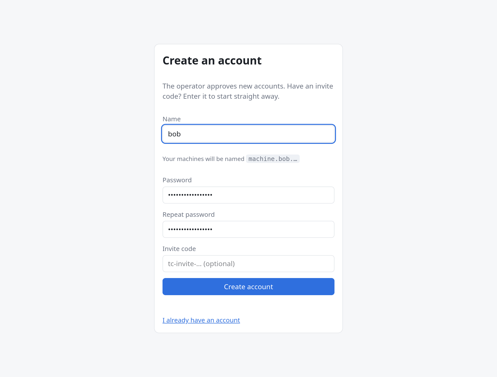
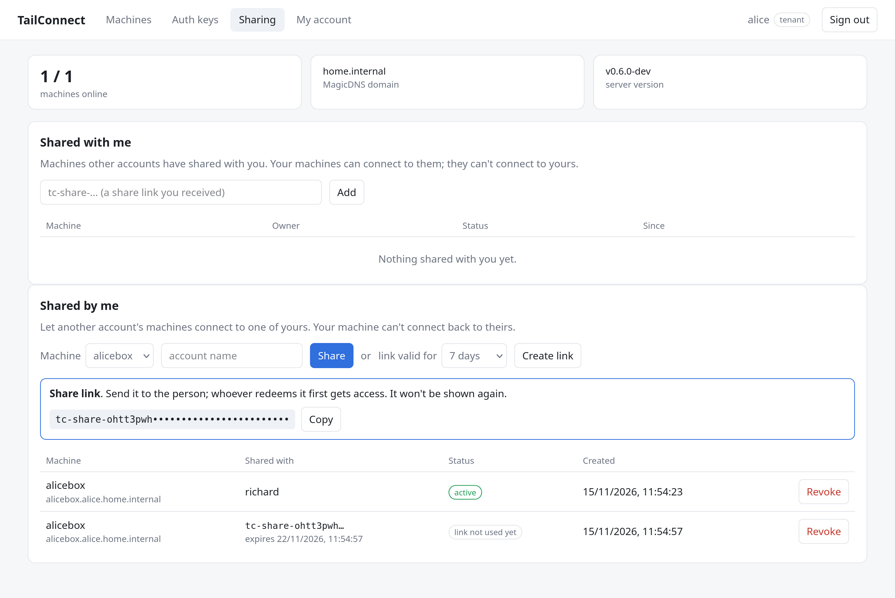
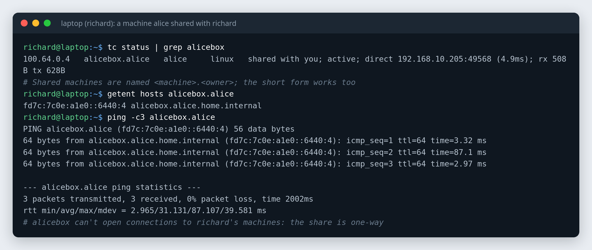
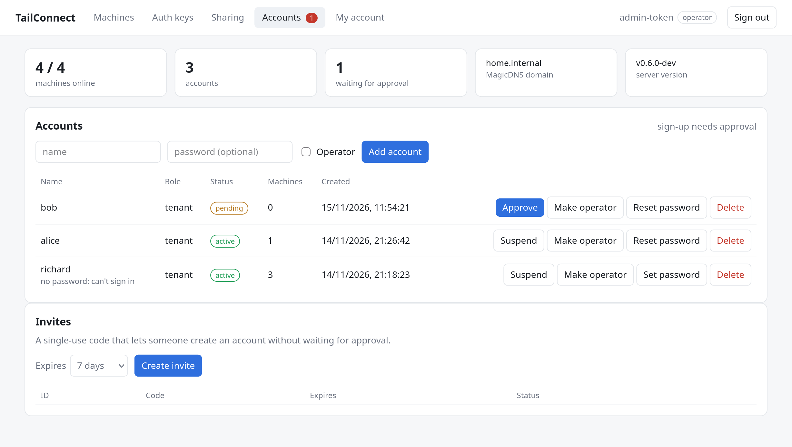

# Usage

How to run a TailConnect server once it's [installed](installation.md): accounts and sign-up, adding devices, sharing machines between accounts, the web portal and admin tools, the `tc` client, MagicDNS and relays.

- [Concepts](#concepts)
- [Common tasks](#common-tasks)
- [Accounts and sign-up](#accounts-and-sign-up)
- [Sharing a machine](#sharing-a-machine)
- [The web portal](#the-web-portal)
- [Admin CLI](#admin-cli)
- [Admin HTTP API](#admin-http-api)
- [The `tc` client](#the-tc-client)
- [Check the mesh](#check-the-mesh)
- [MagicDNS](#magicdns)
- [Relays](#relays)

---

## Concepts

| | |
|---|---|
| **Account** (tenant) | One login (name and password) with its own private network. An account's machines see and reach each other, and nothing of other accounts', unless a machine is shared. The name is part of every machine's DNS name, so it's limited to lowercase letters, digits and `-`. |
| **Operator** | An account that also runs the server: it sees every account and machine, approves sign-ups, suspends accounts and issues invites. As a member of the network, an operator's own machines are as isolated as anyone else's. |
| **Status** | `active`, `pending` (signed up, waiting for an operator's approval) or `suspended`. Pending and suspended accounts can't sign in, and their machines are cut off from the network until the account is active again. |
| **Machine** (device, node) | A computer running `tcd`, belonging to one account. It gets an IPv4 address from `100.64.0.0/10` and a matching IPv6 address, for its lifetime. Its name, taken from its hostname, is unique within the account: two accounts can both have a `laptop`. |
| **Name** | `machine.account.domain`, for example `laptop.alice.tc.internal`. Within an account, the short name (`laptop`) works too. |
| **Auth key** | A `tc-auth-…` secret that lets a device join an account. It can be **single-use** or **reusable**, always **expires**, and can be **revoked**. Revoking a key or letting it expire stops new joins; machines that already joined stay. An **ephemeral** key labels its machines as temporary; removing them automatically comes in milestone 9. |
| **Share** | Permission for another account's machines to connect to one of your machines. It's **one-way**: the shared machine can only reply, never open connections back. A share by name is **pending** until the recipient accepts it; a **share link** is accepted by whoever redeems it first. |
| **Invite** | A single-use `tc-invite-…` code from an operator that lets someone create an account without waiting for approval. |
| **Admin token** | A `tc-admin-…` secret for scripts (the HTTP API) and as a break-glass operator sign-in. Creating a new one replaces the old one. |

Within an account, every machine can reach every other machine. Finer-grained access rules within an account are planned for milestone 9.

## Common tasks

| Task | In the web portal | On the server |
|---|---|---|
| Create your operator account | | `sudo tc-control users create NAME -operator -password` |
| Let someone in | Accounts → Add account, or **Approve** their sign-up, or create an **invite** | `sudo tc-control users create bob -password`, `… users approve bob`, `… invites create` |
| Join a device | Auth keys → Generate key, then on the device `sudo tc up --server URL --authkey tc-auth-…` | `sudo tc-control keys create -user bob` |
| Join many devices (fleet, CI) | tick *Reusable* | `… keys create -user ci -reusable -expiration 720h` |
| Share a machine with another account | Sharing → Share (by name) or Create link | `sudo tc-control shares create NODE_ID ACCOUNT` |
| Accept a share | Sharing → Accept, or paste a link under "Shared with me" | `sudo tc-control shares accept ID` |
| End a share | Sharing → Revoke (owner) or Remove (recipient) | `sudo tc-control shares revoke ID` |
| Rename a machine | Machines → Rename | `sudo tc-control nodes rename 4 build-server` |
| Remove a machine | Machines → Remove (or `sudo tc logout` on it) | `sudo tc-control nodes delete 4` |
| Cut an account off | Accounts → Suspend | `sudo tc-control users suspend bob` |
| Reset a forgotten password | Accounts → Reset password | `sudo tc-control users passwd bob` |
| Stop a leaked key | Auth keys → Revoke | `sudo tc-control keys revoke 7` |

Changes reach every connected machine within about a second.

---

## Accounts and sign-up

**Your own account.** Create the first operator account on the server; the password is prompted for (or read from standard input in scripts):

```sh
sudo tc-control users create richard -operator -password
```

**Other people's accounts.** Either create them yourself (Accounts → Add account, or `tc-control users create NAME -password`), or let people sign up in the portal. The server's `-signup` option decides who can:

| `-signup` | What happens when someone fills in *Create an account* |
|---|---|
| `off` | The link isn't shown; only operators create accounts. |
| `approval` (default) | The account is created **pending**. An operator approves it (Accounts → Approve, or `tc-control users approve NAME`). |
| `invite` | An invite code is required; the account is active straight away. |
| `open` | The account is active straight away. Only for servers that trusted people can reach. |

In every mode except `off`, a valid invite code skips approval. Operators create invites in the portal (Accounts → Create invite) or with `tc-control invites create`; each works once, and expires (7 days by default).

<table>
<tr>
<td width="50%"><br><sub><b>Sign in</b> with your account. <i>Create an account</i> appears when sign-up is on.</sub></td>
<td width="50%"><br><sub><b>Sign up</b>. The form shows what the machines will be called.</sub></td>
</tr>
</table>

For sign-up to be useful, people must be able to reach the portal: see [Open the portal to other people](installation.md#open-the-portal-to-other-people).

**Suspending** an account (Accounts → Suspend, or `tc-control users suspend NAME`) signs it out, cuts its machines off within a second (they keep their keys and show `Notice: … account is suspended` in `tc status`), and stops its shares. **Reactivating** restores everything without touching the machines. **Deleting** an account removes its machines, keys and shares for good.

Passwords are at least 10 characters. Changing a password, the role or the status signs the account out everywhere else.

---

## Sharing a machine

Share a machine when someone in another account should be able to use it (a file server, a build machine, a printer host), without joining your network or seeing your other machines.



1. **Offer it.** In Sharing → *Shared by me*, pick the machine and either type the other account's name and click **Share**, or click **Create link** and send the `tc-share-…` code (single use, valid for the time you pick).
2. **They accept.** A share by name appears under *Shared with me* in their portal, with a badge on the Sharing tab; they click **Accept**. A link is accepted by pasting it into *Shared with me* and clicking **Add**.
3. **It's in effect.** Within a second, all of their machines can connect to yours, by name: `nas.alice` (short for `nas.alice.tc.internal`).

| | Their machines → your shared machine | Your shared machine → their machines | Your other machines |
|---|---|---|---|
| Visible | yes | yes, so replies work | no |
| Can connect | **yes** | **no**: only replies to their connections | no |

On the recipient's machines, `tc status` shows the machine as `shared with you`; on your shared machine, their machines show as `has access to this machine`:



**Ending a share.** The owner clicks **Revoke**, the recipient **Remove** (or **Decline** while it's pending), or an operator runs `tc-control shares revoke ID`. Access ends within a second. Shares also end when the machine is deleted or moves to another account, and stop working while either account is suspended.

**Both ways.** If two accounts each share a machine with the other, each may open connections to the other's shared machine. That's how to get a two-way link between two specific machines.

The one-way rule is enforced by the packet filter on each recipient machine, so even a compromised shared machine can't open connections into the other account ([how](how-it-works.md#sharing-and-the-packet-filter)).

---

## The web portal

The portal listens on `http://127.0.0.1:7741` on the server by default. From your workstation:

```sh
ssh -L 7741:127.0.0.1:7741 you@server      # then open http://localhost:7741
```

To let other people use it (to sign up, manage their machines and share), make it reachable over HTTPS: see [Open the portal to other people](installation.md#open-the-portal-to-other-people). Sessions last 12 hours.

**Machines** lists your machines (operators: everyone's, with an Account column), with online state (seen in the last 5 minutes), names, addresses, OS and last contact. **Rename** changes the machine's name; **Remove** disconnects it and deletes it from the network.


A tenant sees only its own machines, and no Accounts tab:


**Auth keys** creates keys for your account (operators can pick any account). The key is shown once; the table shows each key's uses and status.


**Sharing** is described [above](#sharing-a-machine). **My account** changes your password.

**Accounts** (operators only) lists every account with its role, status and machine count. Pending sign-ups come first, with a count on the tab. From here you approve, suspend, reactivate, make operator or tenant, reset passwords and delete accounts (not your own, so you can't lock yourself out), and create and revoke invites.



**The admin token.** *Use the admin token* on the sign-in page signs in as an operator without an account; it's meant for recovery. Scripts use the same token with the HTTP API.

## Admin CLI

`tc-control` doubles as the admin CLI. It works directly on the database, whether or not the server is running, and its changes reach machines within a second.


```
tc-control users create NAME [-operator] [-password] | list | delete NAME
tc-control users passwd NAME | approve NAME | suspend NAME | activate NAME
tc-control users role NAME operator|tenant
tc-control invites create [-expiration 168h] | list | revoke ID
tc-control keys create -user NAME [-reusable] [-ephemeral] [-expiration 24h]
tc-control keys list [-user NAME] | revoke ID
tc-control nodes list [-user NAME] | delete ID | rename ID NEWNAME
tc-control shares list [-user NAME] | create NODE_ID ACCOUNT | link NODE_ID [-expiration 168h]
tc-control shares accept ID | revoke ID
tc-control admin-token
tc-control version
```

- `list` commands take `-json` for scripts (password hashes are never included).
- `users create -password` and `users passwd` prompt twice on a terminal, or read one line from standard input: `echo "$PW" | tc-control users passwd bob`.
- `shares accept` accepts on the recipient's behalf.
- Flags can go before or after arguments. On an installed server the database is found automatically; elsewhere pass `-db PATH` or set `TC_CONTROL_DB`. Run it with `sudo`: the database is readable only by root and the service.

## Admin HTTP API

The portal is built on a JSON API at the same address. Browsers use the session cookie; scripts send the admin token as a bearer token, which acts as an operator:

```sh
export TC_ADMIN_TOKEN=tc-admin-…
curl -H "Authorization: Bearer $TC_ADMIN_TOKEN" http://127.0.0.1:7741/api/v1/nodes
```

**Public (no sign-in):**

| Method and path | Body | |
|---|---|---|
| `GET /api/config` | | `{signup, version}` |
| `POST /api/login` | `{"login", "password"}` or `{"token"}` | sets the session cookie |
| `POST /api/logout` | | |
| `POST /api/signup` | `{"login", "password", "invite"}` | 201 `{login, status}` (`pending` or `active`) |

**Any account** (tenants see and act on their own data; operators on everyone's):

| Method and path | Body | Result |
|---|---|---|
| `GET /api/v1/status` | | version, domain, control URL, machine counts; for operators also account and pending counts |
| `GET /api/v1/me` | | `{login, role, status, operator, token}` |
| `POST /api/v1/me/password` | `{"current", "new"}` | |
| `GET /api/v1/nodes` | | `[{id, name, fqdn, user, hostname, os, ipv4, ipv6, endpoints, nodeKey, ephemeral, created, lastSeen, online}]` |
| `POST /api/v1/nodes/{id}/rename` | `{"name"}` | |
| `DELETE /api/v1/nodes/{id}` | | |
| `GET /api/v1/keys` | | `[{id, prefix, user, reusable, ephemeral, uses, created, expires, revoked, usable}]` |
| `POST /api/v1/keys` | `{"ttl": "24h", "reusable", "ephemeral", "user"}` | 201 `{key, info}`; `user` defaults to you (operators may name any account). TTL up to 2160h. |
| `DELETE /api/v1/keys/{id}` | | revokes |
| `GET /api/v1/shares` | | `{outgoing: [...], incoming: [...]}`; each `{id, nodeId, machine, fqdn, owner, recipient, status, inEffect, link, linkPrefix, created, acceptedAt, expires}` |
| `POST /api/v1/nodes/{id}/shares` | `{"recipient"}` | 201 the pending share |
| `POST /api/v1/nodes/{id}/share-links` | `{"ttl": "168h"}` | 201 `{code, share}`; TTL up to 720h |
| `POST /api/v1/shares/{id}/accept` | | the recipient accepts |
| `POST /api/v1/shares/redeem` | `{"code"}` | the share behind a link |
| `DELETE /api/v1/shares/{id}` | | revoke, decline or leave |

**Operators only:**

| Method and path | Body | |
|---|---|---|
| `GET /api/v1/users` | | `[{name, role, status, hasPassword, created, nodes}]` |
| `POST /api/v1/users` | `{"name", "password", "role"}` | password and role optional |
| `DELETE /api/v1/users/{name}` | | also removes their machines, keys and shares |
| `POST /api/v1/users/{name}/status` | `{"status": "active" \| "suspended"}` | approve, suspend, reactivate |
| `POST /api/v1/users/{name}/role` | `{"role": "operator" \| "tenant"}` | |
| `POST /api/v1/users/{name}/password` | `{"password"}` | |
| `GET /api/v1/invites`, `POST /api/v1/invites` `{"ttl"}`, `DELETE /api/v1/invites/{id}` | | invites (TTL up to 720h) |

Write requests must send `Content-Type: application/json`. Another account's machines, keys and shares look like they don't exist (404). Errors come back as `{"error": "…"}`. Sign-in and sign-up allow 10 attempts per IP address, then one every 6 seconds.

---

## The `tc` client

`tc` talks to the local `tcd` over a Unix socket. Anyone can run `tc status`, `tc ip` and `tc version`; `up`, `down` and `logout` need root.

| Command | What it does |
|---|---|
| `tc up --server URL --authkey KEY [--hostname NAME] [--server-key mkey:…]` | Join an account the first time. |
| `tc up` | Reconnect after `tc down`. Also: `--server NEW` after the server moves; `--authkey` to re-register, e.g. after the machine was removed (a key of another account moves the machine there). |
| `tc down` | Disconnect. The tunnel, routes and DNS settings are removed and the machine stays registered; it stays down across reboots until `tc up`. |
| `tc status [--json]` | This machine, its peers, and how each is reached |
| `tc ip [-4\|-6] [PEER]` | This machine's addresses, or a peer's (by name or short name) |
| `tc logout` | Leave: tells the server to delete this machine and forgets its keys |
| `tc version` | Client version |

Global option: `--socket PATH` (or `$TC_SOCKET`), for a `tcd` with a non-default socket, such as [userspace mode](installation.md#without-root-userspace-mode).

## Check the mesh


`tc status` prints a header, then one line per machine:

```
State: Running   control: http://192.168.10.131:7740   relay: 1
MagicDNS: richard.home.internal (systemd-resolved, only .home.internal names)
100.64.0.2   laptop           richard   linux   (this machine)
100.64.0.1   devbox           richard   linux   active; direct 192.168.10.205:41641 (5.1ms); rx 348B tx 436B
100.64.0.4   alicebox.alice   alice     linux   shared with you; active; direct 192.168.10.205:49568 (4.9ms)
```

| You see | Meaning |
|---|---|
| `State: Running` | Connected to the server and the tunnel is up. `Starting` means connecting; a `Warning:` line says why if it takes a while. The tunnel keeps working on its last map even while the server is unreachable. |
| `Notice: …` | A message from the server, for example that the account is suspended |
| `relay: 1` | This machine's home relay region |
| `alicebox.alice`, `alice` | Another account's machine (name, then owner), in this network because of a share |
| `shared with you` / `has access to this machine` | You can connect to it, and it can only reply / it can connect to this machine (this machine is shared with its account) |
| `active` / `idle` | Whether a WireGuard handshake with that peer completed in the last 3 minutes. Idle peers cost nothing and connect on the first packet. |
| `direct ADDR (N ms)` | Packets go straight to ADDR, often the peer's NAT-mapped public address, with the measured round-trip time |
| `relay N` | Packets go through relay region N: normal for a second or two while a direct path is found, permanent when a firewall or NAT blocks direct UDP ([troubleshooting](troubleshooting.md#peers-stay-on-relay)) |

`ip route show dev tc0` shows a route per peer (tagged `proto 124`) plus one for `100.100.100.100`, the MagicDNS resolver.

---

## MagicDNS

Every machine is reachable as `machine.account.domain`, where the domain is the server's `-domain` (`tc.internal` by default). Each machine searches its own account's domain first, then the base domain, so:

- `laptop` is your account's laptop (`laptop.richard.home.internal`);
- `alicebox.alice` is a machine alice shared with you (`alicebox.alice.home.internal`).

Reverse lookups of tunnel addresses return names, and renames reach every machine within a few seconds.


Each machine runs its own resolver at `100.100.100.100`, answering from the network map it already has, so it only knows its own account's machines and machines shared with it. How `tcd` points the OS at it depends on `tcd -dns` (set in `/etc/default/tcd`):

| Mode | When `auto` picks it | What it does |
|---|---|---|
| `systemd-resolved` | `/etc/resolv.conf` points at resolved's stub (127.0.0.53): Ubuntu, Fedora, Mint, Debian with resolved | Split DNS on the `tc0` link: only `.<domain>` names and reverse lookups of tunnel addresses go to MagicDNS; everything else keeps using your normal DNS. |
| `file` | any other `/etc/resolv.conf` | Rewrites `resolv.conf` to use `100.100.100.100` with the search domains, keeping your options. MagicDNS forwards other names to the nameservers that were there before. The original comes back when `tcd` stops (or at the next start after a crash). |
| `off` | userspace mode, or `tcd` in a network namespace other than the host's | Leaves the OS alone. Query the resolver directly: `dig @100.100.100.100 laptop.richard.tc.internal`. |

The `MagicDNS:` line in `tc status` shows the account domain and the mode in use, and any error setting it up.

**Send all DNS through the tunnel.** Start the server with `-dns-nameservers 1.1.1.1,9.9.9.9`: machines then send every query to MagicDNS, which answers `.<domain>` names itself and forwards the rest. **Turn it off** for the whole server with `-magic-dns=false`, or on one machine with `-dns off`.

Current limits: queries are UDP only (a forwarded answer too big for UDP comes back truncated, and the client's retry over TCP fails).

---

## Relays

When two machines can't reach each other directly (blocked UDP, strict NATs), their WireGuard packets go through a **relay**, which forwards packets that are already encrypted and can't read them. Each machine keeps a connection to its **home relay**: the region with the lowest latency, measured with STUN.

**The built-in relay.** `tc-control` serves a relay at `/relay` on its control port, plus a STUN server on UDP 3478. It serves only registered machines of active accounts, and only carries packets between machines that may talk: the same account, or a machine and the account it's shared with.

**More relays.** If your machines are spread across the world, run `tc-relay` close to them so relayed traffic doesn't cross the globe twice:

```sh
tc-relay -allow-any -listen :7742 -stun-listen :3478 -public-url http://relay-eu.example.com:7742/relay
```

It prints an example relay map. Save the regions as JSON on the server and start `tc-control` with `-relay-map /etc/tailconnect/relays.json`:

```json
{
  "Regions": [
    {"ID": 1, "Code": "home", "Name": "tc-control (embedded)",
     "Nodes": [{"Name": "1a", "URL": "/relay", "STUNPort": 3478}]},
    {"ID": 2, "Code": "eu", "Name": "Frankfurt",
     "Nodes": [{"Name": "2a", "URL": "http://relay-eu.example.com:7742/relay", "STUNPort": 3478}]}
  ]
}
```

- A relative URL such as `/relay` is the relay built into the server; list it if you keep `-relay` on (the default).
- `STUNPort` is the region's STUN server (`0` for none); `HostName` overrides the STUN host (default: the URL's host).
- Machines pick the region with the lowest STUN latency as home, switching only when another region is at least 30% faster.

`tc-relay` requires `-allow-any`. It can't check registrations or accounts with the server yet, so it relays for any machine that proves it owns its key, including between accounts. Traffic stays end-to-end encrypted, and machines still only accept packets from their own peers, but anyone who can reach the relay can use its bandwidth. All options are in the [configuration reference](configuration.md#tc-relay).
